# Allocation entre facteurs actions

Projet de recherche construit étape par étape. Chaque étape répond à une question.

## Étape 1 : pourquoi s'intéresser aux modèles à facteurs ?

- **Les facteurs expliquent l'essentiel du risque d'un portefeuille diversifié.** Sur un titre isolé, le risque spécifique domine ; dès qu'on diversifie, il s'efface et il ne reste que l'exposition à quelques facteurs communs (marché, taille, value, momentum, qualité, faible volatilité). Comme le résume Roncalli (2017) : *« Common risk factors are the only bets that are compatible with diversification. »*
- **Une bonne partie de l'« alpha » est en fait du facteur.** La performance d'un gérant ou d'une stratégie se décompose en expositions factorielles plus un résidu, souvent faible. Raisonner en facteurs permet de savoir ce que l'on porte réellement.
- **Les facteurs sont des primes de risque, pas des prévisions.** Ils rémunèrent un risque supporté dans les mauvais états du monde ou exploitent une anomalie persistante. On peut donc les détenir sans savoir prédire leur rendement le mois suivant.
- **Prédire les rendements ne marche pas (ou presque).** Mon projet précédent, [strat-invest-direct](https://github.com/Anto279/strat-invest-direct), testait des prévisions de rendement (ARIMA, XGBoost) sur 8 ETF : elles ne font pas mieux que la moyenne historique (R² hors échantillon proche de zéro ou négatif), et la validation croisée leur attribue un poids nul. Le **risque**, lui, se prévoit : le GARCH bat significativement l'EWMA.
- **D'où l'ERC (Equal Risk Contribution).** Si l'on ne sait prévoir que le risque, il faut une allocation qui n'utilise que le risque. L'ERC donne à chaque facteur la même contribution au risque total, sans aucune hypothèse de rendement espéré. Roncalli (2017) la décrit comme *« a highly-regularized MVO portfolio »*, robuste et diversifiée.
- **C'est l'approche d'Amundi.** La gamme Dynamic Multi Factors combine des facteurs (value, momentum, qualité, faible volatilité, taille) avec une allocation stratégique en budget de risque, ajustée ensuite de façon tactique. La stratégie Global Dynamic Multi-Factor Equity a reçu le prix *Equity Multi-Factor Solution Provider of the Year* (PP Investment Awards 2024).

## Étape 2 : le modèle Fama-French + momentum

### 2.1 La formule

Pour un actif ou un portefeuille $i$, au mois $t$ :

$$
R_{i,t} - R_{f,t} = \alpha_i + \beta_i\,\mathrm{MKT}_t + s_i\,\mathrm{SMB}_t + h_i\,\mathrm{HML}_t + r_i\,\mathrm{RMW}_t + c_i\,\mathrm{CMA}_t + m_i\,\mathrm{MOM}_t + \varepsilon_{i,t}
$$

C'est le modèle à cinq facteurs de Fama et French (2015), complété par le facteur momentum de Carhart (1997).

En prenant l'espérance, et si le modèle est juste ($\alpha_i = 0$) :

$$
\mathbb{E}[R_i] - R_f = \beta_i\,\lambda_{\mathrm{MKT}} + s_i\,\lambda_{\mathrm{SMB}} + h_i\,\lambda_{\mathrm{HML}} + r_i\,\lambda_{\mathrm{RMW}} + c_i\,\lambda_{\mathrm{CMA}} + m_i\,\lambda_{\mathrm{MOM}}, \qquad \lambda_k = \mathbb{E}[F_k]
$$

Le rendement attendu d'un actif = somme de (son exposition à chaque facteur) × (la prime moyenne de ce facteur).

### 2.2 D'où vient cette formule

- **CAPM (Sharpe, 1964)** : un seul facteur, le marché. $\mathbb{E}[R_i] - R_f = \beta_i\,(\mathbb{E}[R_M] - R_f)$. Seul le risque non diversifiable est rémunéré.
- **Le CAPM échoue empiriquement** : les petites capitalisations (Banz, 1981) et les actions « value », bon marché par rapport à leurs fonds propres (Basu, 1977 ; Rosenberg et al., 1985), rapportent plus que ce que leur bêta prévoit.
- **Fama-French 3 facteurs (1993)** : on ajoute deux facteurs qui captent ces écarts, SMB (taille) et HML (value).
- **Carhart (1997)** : ajoute MOM, car les gagnants des 12 derniers mois continuent de surperformer (Jegadeesh et Titman, 1993), ce que les trois facteurs n'expliquent pas.
- **Fama-French 5 facteurs (2015)** : ajoute RMW (rentabilité) et CMA (investissement). Ces deux facteurs ne sont pas choisis au hasard : ils découlent du modèle d'actualisation des dividendes, réécrit avec les données comptables :

$$
\frac{M_t}{B_t} = \frac{\sum_{\tau \ge 1} \mathbb{E}\left[Y_{t+\tau} - dB_{t+\tau}\right] / (1+r)^{\tau}}{B_t}
$$

  $M$ = capitalisation, $B$ = fonds propres comptables, $Y$ = bénéfices, $dB$ = investissement (variation des fonds propres), $r$ = rendement attendu. À tout le reste égal, $r$ est plus élevé quand le prix est bas par rapport aux fonds propres (value), quand la rentabilité est forte (RMW) et quand l'investissement est faible (CMA).

### 2.3 Pourquoi ce modèle ici (lien avec l'étape 1)

- C'est le modèle de référence, en recherche comme en gestion : les facteurs sont publics, construits de façon transparente et disponibles depuis 1963 (bibliothèque de Kenneth French).
- Sur des portefeuilles diversifiés, il explique l'essentiel des variations de rendement : le $R^2$ des régressions dépasse souvent 90 % (Fama et French, 1993). C'est exactement l'idée de l'étape 1 : une fois diversifié, il ne reste que des facteurs.
- Chaque facteur est lui-même un **portefeuille investissable** (long-short). On peut donc les traiter comme des actifs et allouer entre eux, avec une méthode qui n'a besoin que de leur risque (ERC).
- Ils recouvrent les styles du processus Amundi : value (HML), momentum (MOM), qualité (proche de RMW et CMA), taille (SMB).

### 2.4 Les paramètres

| Symbole | Ce que c'est | Nature |
|---|---|---|
| $R_{i,t}$ | rendement de l'actif ou du portefeuille $i$ au mois $t$ | rendement (%) |
| $R_{f,t}$ | taux sans risque : bon du Trésor américain à 1 mois | rendement (%) |
| $R_{i,t} - R_{f,t}$ | rendement excédentaire : ce que l'actif rapporte au-delà du placement sans risque | rendement (%) |
| $\mathrm{MKT}, \mathrm{SMB}, \dots, \mathrm{MOM}$ | les facteurs : rendements de portefeuilles construits par Fama-French | rendement (%) |
| $\beta_i, s_i, h_i, r_i, c_i, m_i$ | expositions (« loadings ») : de combien bouge $R_i$ quand le facteur bouge de 1 % | sans unité, estimées par régression MCO sur l'historique |
| $\lambda_k = \mathbb{E}[F_k]$ | prime du facteur $k$ : son rendement moyen | rendement (%) |
| $\alpha_i$ | rendement non expliqué par les facteurs ; vaut 0 si le modèle est juste | rendement (%) |
| $\varepsilon_{i,t}$ | choc spécifique à l'actif $i$, de moyenne nulle | rendement (%) |

Point clé : **les facteurs sont des rendements, pas des caractéristiques brutes.** La capitalisation, le ratio valeur comptable / valeur de marché ou la rentabilité servent seulement à **trier** les actions pour construire les portefeuilles. Ce qui entre dans la régression, c'est le rendement mensuel de ces portefeuilles.

**La prime d'un facteur est-elle celle d'un portefeuille diversifié plutôt que d'un titre ? Oui, avec une nuance.**

- Oui, chaque facteur est le rendement d'un portefeuille très diversifié (des centaines à des milliers d'actions). Une prime factorielle est donc la prime d'un portefeuille, pas d'un titre.
- Le membre de gauche, $R_i$, peut en revanche être n'importe quoi : une action seule, un fonds, un portefeuille. Le modèle s'applique aussi à un titre seul, mais il l'explique mal ($R^2$ bien plus faible), car le terme spécifique $\varepsilon_i$ y pèse lourd. Sur un portefeuille diversifié, $\varepsilon$ se compense et le $R^2$ devient très élevé.
- Le risque spécifique $\varepsilon_i$ n'est pas rémunéré : il se diversifie gratuitement. Seule l'exposition aux facteurs donne droit à une prime.

### 2.5 Comment Fama et French calculent les facteurs

Les facteurs ne sont pas calculés sur notre portefeuille. Fama et French les calculent sur l'ensemble des actions américaines (NYSE, AMEX, NASDAQ, environ 4 000 titres) et publient chaque mois leur rendement sur le site de Kenneth French. On télécharge ces séries telles quelles.

**La recette, identique pour tous les facteurs**

1. On prend toutes les actions américaines.
2. On mesure pour chacune une caractéristique (sa taille, son prix par rapport à sa valeur comptable, sa rentabilité...).
3. On les classe selon cette caractéristique et on forme deux groupes : les 30 % du haut et les 30 % du bas. Les 40 % du milieu ne servent pas.
4. Le facteur du mois = rendement moyen d'un groupe − rendement moyen de l'autre.

Un facteur est donc le résultat d'un pari « j'achète un groupe, je vends l'autre ». Par exemple, si en mars les actions bon marché gagnent 2 % et les actions chères 0,5 %, le facteur value vaut +1,5 % en mars.

Trois précisions :

- **Les groupes sont refaits une fois par an, fin juin**, avec les comptes de l'année précédente (déjà publiés à cette date). Seul le momentum est refait chaque mois.
- **Chaque action pèse selon sa capitalisation** dans le rendement de son groupe.
- **Le tri est fait séparément chez les petites et chez les grandes entreprises**, puis on fait la moyenne des deux. Sinon, le facteur value serait en partie un pari sur la taille, car les actions bon marché sont souvent des petites entreprises. La frontière entre « petite » et « grande » est la médiane des capitalisations du NYSE.

**Les six facteurs**

| Facteur | Groupe acheté | Groupe vendu | Critère de tri |
|---|---|---|---|
| MKT (marché) | tout le marché | placement sans risque | aucun |
| SMB (taille) | petites entreprises | grandes entreprises | capitalisation boursière |
| HML (value) | actions bon marché | actions chères | fonds propres comptables / capitalisation |
| RMW (rentabilité) | entreprises très rentables | entreprises peu rentables | bénéfice d'exploitation / fonds propres |
| CMA (investissement) | entreprises qui investissent peu | entreprises qui investissent beaucoup | croissance du total de l'actif sur un an |
| MOM (momentum) | actions qui ont le plus monté | actions qui ont le plus baissé | rendement des 12 derniers mois, sans le dernier |

**MKT, le marché.** Rendement de toutes les actions américaines moins le taux d'un bon du Trésor à un mois. Pourquoi ça rapporte : les actions chutent pendant les récessions, au pire moment pour l'épargnant. Ce risque ne disparaît pas en diversifiant, donc il est rémunéré.

**SMB, la taille.** On sépare les entreprises en deux selon leur capitalisation : petites d'un côté, grandes de l'autre. SMB = rendement des petites − rendement des grandes. Pourquoi ça rapporte : les petites entreprises sont plus fragiles en période de crise et leurs actions s'échangent moins facilement. Les investisseurs demandent un surplus de rendement pour les détenir. Cet effet est faible depuis les années 1980.

**HML, la value.** Pour chaque entreprise, on divise ses fonds propres comptables (ce que vaut l'entreprise dans ses comptes) par sa capitalisation (ce qu'en dit la Bourse). Un ratio élevé signale une action bon marché, un ratio faible une action chère. HML = rendement des 30 % les moins chères − rendement des 30 % les plus chères. Pourquoi ça rapporte : les entreprises bon marché sont souvent en difficulté et souffrent plus quand l'économie se retourne, c'est un risque. Autre lecture : les investisseurs s'emballent pour les entreprises en forte croissance et les paient trop cher.

**RMW, la rentabilité.** Pour chaque entreprise, on calcule son bénéfice d'exploitation (chiffre d'affaires moins coûts de production, frais généraux et intérêts) divisé par ses fonds propres. RMW = rendement des entreprises les plus rentables − rendement des moins rentables. Pourquoi ça rapporte : à prix égal, une entreprise plus rentable produit plus de bénéfices pour ses actionnaires. Le marché semble sous-estimer combien cette rentabilité dure dans le temps.

**CMA, l'investissement.** Pour chaque entreprise, on regarde de combien son total de l'actif a augmenté sur la dernière année. Une forte hausse veut dire qu'elle investit beaucoup (usines, rachats d'entreprises...). CMA = rendement des entreprises qui investissent peu − rendement de celles qui investissent beaucoup. Pourquoi ça rapporte : une entreprise investit beaucoup quand l'argent lui coûte peu, c'est-à-dire quand ses actionnaires attendent un rendement faible. Les dirigeants ont aussi tendance à surinvestir, et le marché paie trop cher ces projets.

**MOM, le momentum.** Pour chaque action, on calcule son rendement sur les 12 derniers mois, en excluant le dernier mois (une action qui a beaucoup monté le mois dernier a tendance à rebaisser un peu juste après, effet de très court terme qu'on veut écarter). MOM = rendement des 30 % qui ont le plus monté − rendement des 30 % qui ont le plus baissé. Les groupes sont refaits chaque mois. Pourquoi ça rapporte : les investisseurs réagissent lentement aux nouvelles, donc les tendances se prolongent quelques mois. Ce n'est pas vraiment une prime de risque mais plutôt une anomalie de comportement (Roncalli, 2017). Elle peut s'effondrer brutalement quand le marché repart d'un coup, comme en 2009 (Daniel et Moskowitz, 2016).

## Étape 3 : la base de données

Tout le code et les résultats de cette étape sont dans le notebook [`notebooks/etape3_description_base.ipynb`](notebooks/etape3_description_base.ipynb) : chaque calcul est suivi de son résultat.

### 3.1 Ce que contient la base

- **Source** : bibliothèque de Kenneth French, deux fichiers téléchargés le 15 octobre 2026 (base CRSP d'août 2026), conservés dans [`data/raw/`](data/raw/).
- **Une ligne = un mois**, de **juillet 1963 à août 2026**, soit **758 mois**. La valeur d'une ligne est le rendement réalisé pendant le mois.
- **Une colonne = un facteur**, en **rendement mensuel en %** : `Mkt-RF`, `SMB`, `HML`, `RMW`, `CMA`, `Mom`. S'y ajoute `RF`, le taux sans risque mensuel, qui n'est pas un facteur.
- Le momentum est disponible depuis 1927, mais les cinq autres facteurs commencent en juillet 1963 : la base commune démarre donc à cette date.
- Aucune valeur manquante, aucun mois absent.
- Sur la période, le taux sans risque vaut en moyenne 4,35 % par an, avec un pic à 16,2 % en juin 1981 et un plancher à 0 % fin 2008.

### 3.2 Statistiques descriptives

| | Mkt-RF | SMB | HML | RMW | CMA | Mom |
|---|---:|---:|---:|---:|---:|---:|
| Rendement annualisé (%) | 7,2 | 2,2 | 3,5 | 3,0 | 2,9 | 7,2 |
| Volatilité annualisée (%) | 15,4 | 10,5 | 10,3 | 7,9 | 7,2 | 14,6 |
| Ratio de Sharpe | 0,47 | 0,21 | 0,34 | 0,38 | 0,41 | 0,49 |
| t-stat de la moyenne | 3,7 | **1,7** | 2,7 | 3,0 | 3,2 | 3,9 |
| Mois positifs (%) | 60 | 50 | 54 | 56 | 52 | 62 |
| Pire mois (%) | −23,2 (oct. 1987) | −15,5 (mars 2000) | −13,8 (mars 2020) | −18,9 (fév. 2000) | −7,1 (mai 2023) | −34,4 (avr. 2009) |
| Meilleur mois (%) | 16,1 (oct. 1974) | 18,5 (fév. 2000) | 12,9 (janv. 2022) | 13,0 (nov. 2000) | 9,0 (fév. 2001) | 18,1 (fév. 2000) |
| Asymétrie | −0,49 | 0,36 | 0,09 | −0,24 | 0,26 | **−1,29** |
| Kurtosis en excès | 1,7 | 3,1 | 2,2 | **10,4** | 1,3 | **9,5** |
| Autocorrélation à 1 mois | 0,04 | 0,05 | 0,16 | 0,14 | 0,13 | 0,04 |
| Perte maximale (%) | −55,8 | −56,5 | −57,8 | −41,8 | −27,6 | −57,8 |
| Période de la perte maximale | 11/1968 à 09/1974 | 07/1983 à 03/1999 | 12/2006 à 09/2020 | 08/1998 à 02/2000 | 12/2022 à 10/2025 | 11/2008 à 09/2009 |

Rendement annualisé $= 12\,\bar r$, volatilité annualisée $= \sqrt{12}\,\hat\sigma$, Sharpe $= \sqrt{12}\,\bar r/\hat\sigma$, t-stat $= \bar r / (\hat\sigma/\sqrt{T})$. Le Sharpe se calcule sans retrancher de taux sans risque, car `Mkt-RF` est déjà un rendement excédentaire et les autres facteurs sont des positions long-short autofinancées.

Ce qu'on en retient :

- **Cinq primes sur six sont significatives** (t-stat > 2). La taille fait exception : 2,2 % par an, t-stat de 1,7, et la moitié des mois seulement sont positifs. Sur 63 ans, on ne peut pas affirmer que la prime de taille existe.
- **Les facteurs long-short ont des Sharpe proches de celui du marché, avec deux fois moins de volatilité** (7 à 10 % par an contre 15 %). CMA a le meilleur Sharpe des facteurs de style (0,41) avec la volatilité la plus faible.
- **Aucun facteur ne suit une loi normale** : le test de Jarque-Bera rejette la normalité pour les six (p-valeur < 10⁻¹³). Le momentum est le cas extrême : asymétrie de −1,29 et kurtosis de 9,5, avec une perte de 34 % en un seul mois (avril 2009). C'est l'anomalie à krachs décrite par Roncalli (2017) à l'étape 1.
- **La kurtosis de RMW (10,4) vient presque entièrement de la bulle internet** : ses meilleur et pire mois tombent en 2000.
- **Les pertes maximales sont longues** : −58 % sur quatorze ans pour la value (2006 à 2020), −56 % sur seize ans pour la taille. Un investisseur concentré sur un seul facteur peut attendre plus d'une décennie avant de revenir à son sommet.
- **HML, RMW et CMA ont une légère autocorrélation** (0,13 à 0,16), contre quasiment zéro pour le marché et le momentum.

### 3.3 Évolution des facteurs

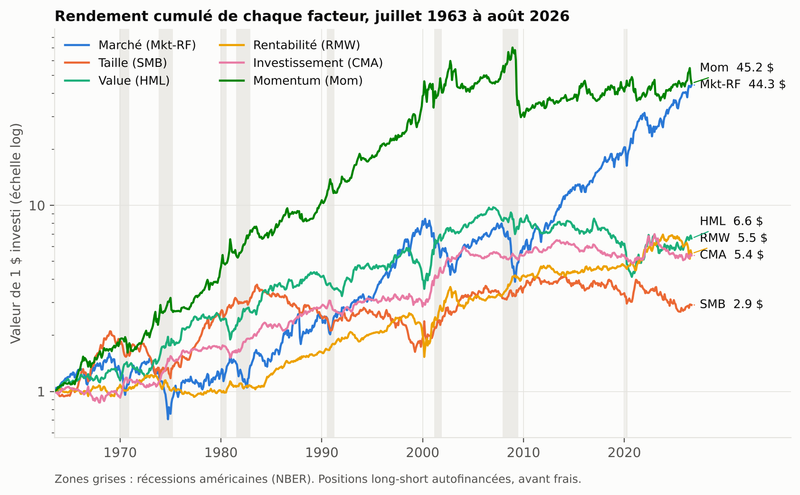

- Sur 63 ans, 1 $ investi devient 45 $ avec le momentum et 44 $ avec le marché, mais seulement 3 à 7 $ avec les autres facteurs (échelle logarithmique). C'est cohérent avec leur volatilité plus faible.
- Le momentum progresse régulièrement jusqu'en 2008, puis perd plus de la moitié de sa valeur en 2009, au moment du rebond des marchés. Il n'a jamais retrouvé son sommet depuis.
- La value (HML) culmine fin 2006 et ne fait que baisser jusqu'en 2020 : c'est la « décennie perdue » de la value.

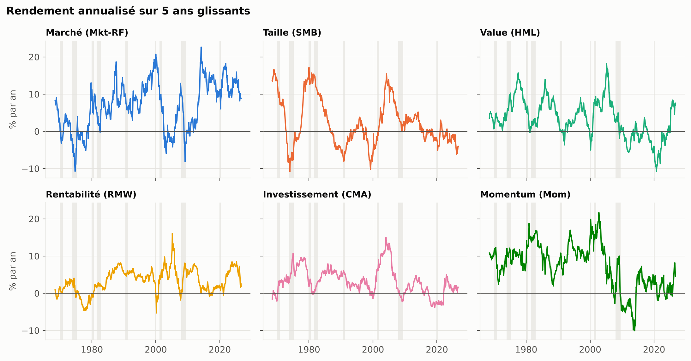

Le rendement annualisé sur 5 ans glissants passe régulièrement en territoire négatif pour tous les facteurs. Le tableau par décennie (notebook) le confirme :

| Décennie | Mkt-RF | SMB | HML | RMW | CMA | Mom |
|---|---:|---:|---:|---:|---:|---:|
| 1960s | 4,5 | 9,6 | 2,3 | 1,4 | −1,0 | 10,5 |
| 1970s | 1,2 | 4,7 | 7,8 | −0,6 | 6,2 | 9,8 |
| 1980s | 8,5 | −0,4 | 5,9 | 4,9 | 5,6 | 9,0 |
| 1990s | 12,8 | −2,1 | 0,1 | 2,3 | 0,2 | 13,5 |
| 2000s | −1,7 | 7,1 | 7,9 | 8,3 | 6,6 | 1,0 |
| 2010s | 13,1 | −0,4 | −2,3 | 1,4 | 0,2 | 3,2 |
| 2020s | 13,1 | −1,6 | 2,1 | 2,7 | 0,4 | 2,7 |

*Rendement annualisé en %. Les années 1960 commencent en juillet 1963, les années 2020 s'arrêtent en août 2026.*

Les facteurs se relaient : dans les années 2000, le marché perd de l'argent pendant que value, rentabilité et investissement rapportent 7 à 8 % par an. Dans les années 2010, c'est l'inverse. Aucun facteur ne gagne à toutes les décennies, ce qui plaide pour les combiner plutôt que d'en choisir un.

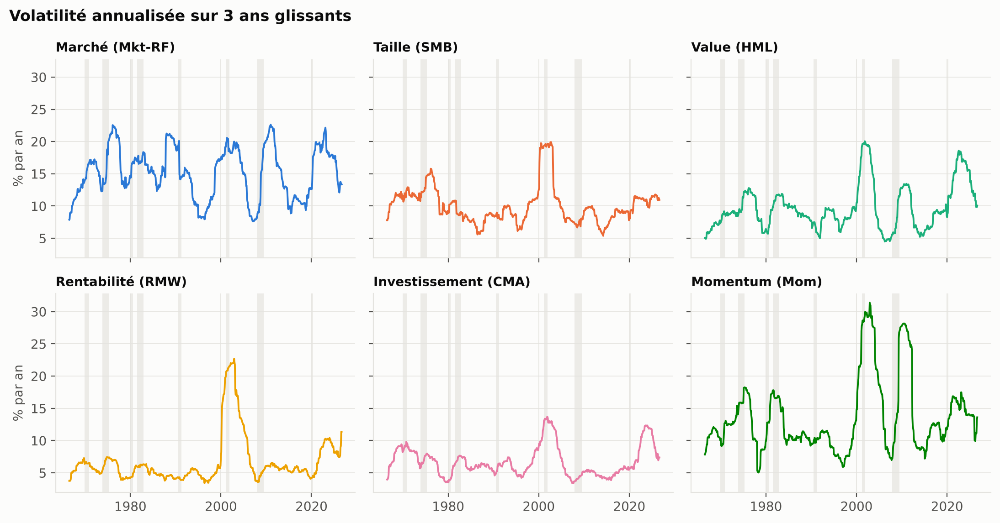

- **La volatilité n'est pas constante.** Sur 3 ans glissants, elle varie d'un facteur 3 (marché) à 6,6 (rentabilité) entre son minimum et son maximum.
- **Les pics sont communs** : 2000-2002 (bulle internet) pour tous les facteurs de style, 2009 pour le marché et le momentum, 2022 pour la value et l'investissement.
- Le risque évolue donc par régimes, ce qui rejoint le constat de l'étape 1 : la volatilité se prévoit, et une allocation qui s'en sert doit l'estimer en continu plutôt qu'une fois pour toutes.

### 3.4 Corrélations

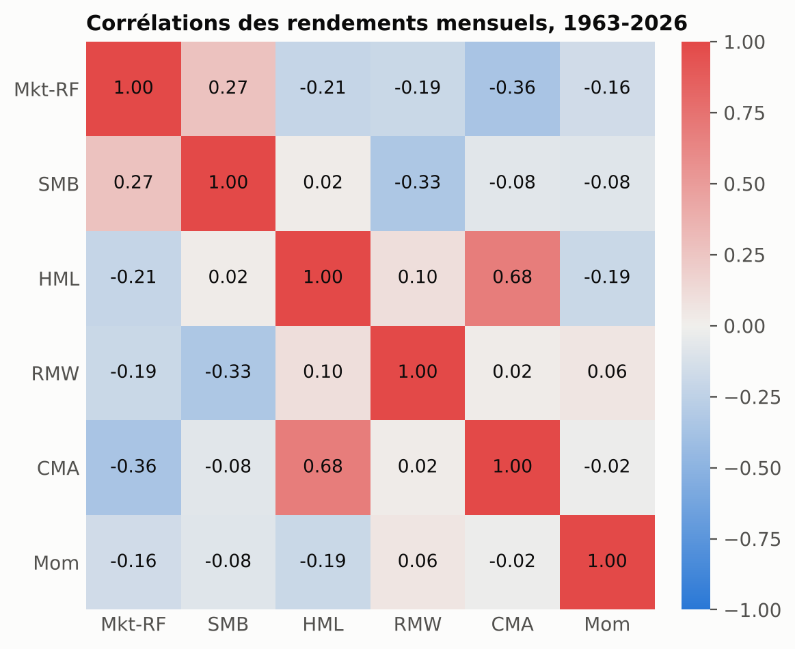

Avec 758 mois, une corrélation est significative au seuil de 5 % dès que $|\rho| > 1{,}96/\sqrt{758} \approx 0{,}07$. La corrélation moyenne en valeur absolue entre deux facteurs n'est que de **0,18**.

**Pourquoi ces corrélations ? Lecture à partir de la construction.** Un facteur est la différence entre deux portefeuilles, $F = L - S$ (jambe longue moins jambe courte). Pour deux facteurs :

$$
\mathrm{Cov}(L_1 - S_1,\ L_2 - S_2) = \mathrm{Cov}(L_1, L_2) - \mathrm{Cov}(L_1, S_2) - \mathrm{Cov}(S_1, L_2) + \mathrm{Cov}(S_1, S_2)
$$

Si les deux jambes longues contiennent les mêmes actions, et les deux jambes courtes aussi, les termes positifs l'emportent et les facteurs sont corrélés. De même, si chaque jambe a une sensibilité $\beta$ au marché, $F = (\beta_L - \beta_S)\,\mathrm{MKT} + \dots$ : le facteur garde une exposition résiduelle au marché, de signe $\beta_L - \beta_S$.

- **HML et CMA : +0,68**, la seule corrélation forte. Les actions bon marché (jambe longue de HML) sont souvent des entreprises qui investissent peu (jambe longue de CMA), et les actions chères sont souvent celles qui croissent vite. Les portefeuilles se recouvrent, d'où la corrélation. C'est la raison pour laquelle Fama et French (2015) trouvent HML presque redondant une fois CMA ajouté.
- **Mkt-RF avec HML (−0,21), RMW (−0,19), CMA (−0,36)** : les entreprises bon marché, rentables ou prudentes ont un bêta plus faible que les entreprises chères, peu rentables ou agressives. On a donc $\beta_L < \beta_S$ et une corrélation négative avec le marché : ces facteurs ont un profil défensif.
- **Mkt-RF et SMB : +0,27** : les petites capitalisations ont un bêta plus élevé que les grandes ($\beta_L > \beta_S$).
- **SMB et RMW : −0,33** : les entreprises peu rentables sont plus souvent petites, donc la jambe courte de RMW recouvre la jambe longue de SMB.
- **HML et Mom : −0,19** : une action qui a beaucoup monté (gagnante, jambe longue de Mom) a vu sa capitalisation grimper, donc son ratio valeur comptable / capitalisation baisser : elle devient « chère » (jambe courte de HML). Le momentum achète mécaniquement ce que la value vend.
- **Paires non significatives** : SMB/HML (0,02), RMW/CMA (0,02), CMA/Mom (−0,02), RMW/Mom (0,06, p = 0,13). SMB/HML est proche de zéro par construction : le tri croisé taille × valeur neutralise la taille dans HML et la valeur dans SMB.

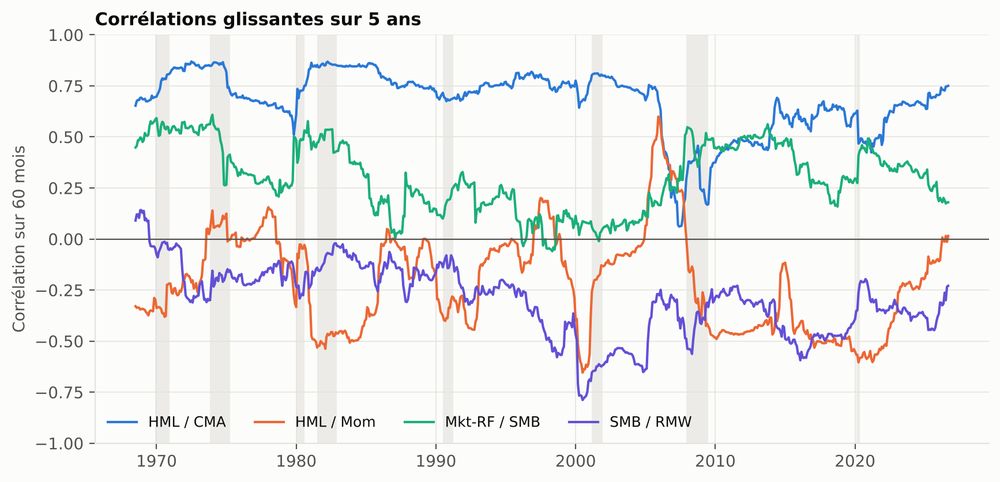

Les corrélations ne sont pas stables dans le temps. HML/CMA reste toujours positive (entre 0,06 et 0,87) car le lien est structurel. HML/Mom, en revanche, oscille entre −0,65 et +0,6 : la corrélation de long terme (−0,19) cache des régimes très différents, dont un pic à +0,6 fin 2005, juste avant la crise de 2008.

### 3.5 Analyse en composantes principales

L'ACP est faite sur les rendements centrés-réduits, c'est-à-dire sur la matrice de corrélation $C = V\Lambda V^\top$. La part de variance expliquée par la composante $k$ vaut $\lambda_k / 6$. Si les six facteurs étaient indépendants, chaque composante expliquerait 1/6 ≈ 17 %.

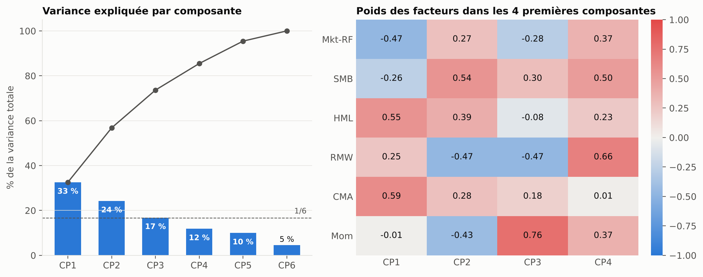

| | CP1 | CP2 | CP3 | CP4 | CP5 | CP6 |
|---|---:|---:|---:|---:|---:|---:|
| Valeur propre | 1,95 | 1,45 | 1,01 | 0,71 | 0,60 | 0,27 |
| Variance expliquée (%) | 33 | 24 | 17 | 12 | 10 | 5 |
| Variance cumulée (%) | 33 | 57 | 74 | 85 | 95 | 100 |

- **Il n'y a pas de composante dominante** : la première n'explique que 33 % de la variance, et il faut cinq composantes pour atteindre 95 %. Les six facteurs portent donc des risques réellement différents.
- **Le critère de Kaiser** ($\lambda > 1$) retient trois composantes, la troisième étant tout juste au-dessus du seuil (1,01).
- **CP1 (33 %), l'axe « défensif contre marché »** : HML et CMA d'un côté, le marché (et un peu SMB) de l'autre. Elle oppose les entreprises bon marché et prudentes au risque de marché.
- **CP2 (24 %), l'axe « petites entreprises fragiles contre qualité »** : SMB et HML d'un côté, RMW et Mom de l'autre. Elle oppose les petites entreprises bon marché aux entreprises rentables qui montent.
- **CP3 (17 %), le momentum seul** : Mom pèse 0,76, RMW −0,47. Le momentum forme une dimension à part.
- **CP6 (5 %) est la différence entre HML et CMA** (poids −0,67 et +0,69). Cette composante a très peu de variance, c'est la traduction de la redondance entre value et investissement.

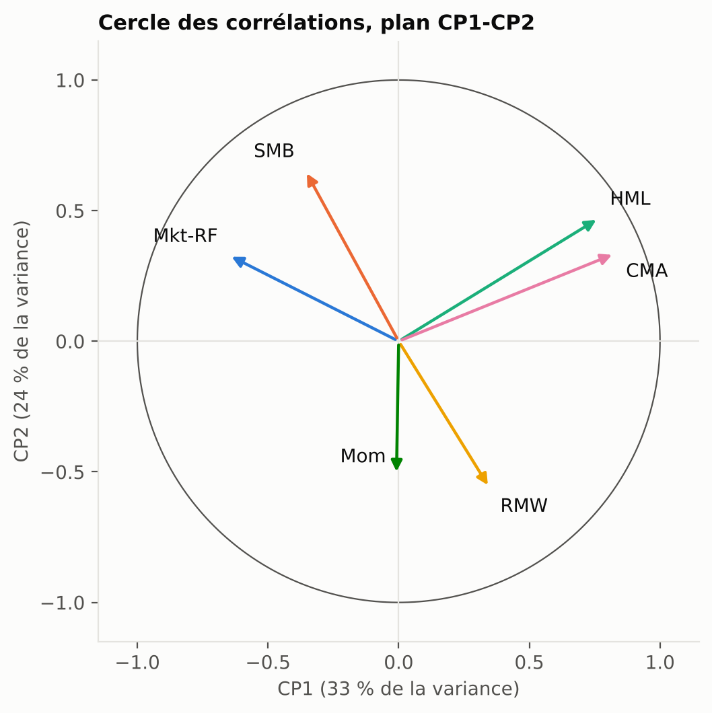

Sur le cercle des corrélations, HML et CMA sont presque superposées et proches du bord : elles sont bien représentées dans ce plan et très corrélées entre elles. Le marché est à l'opposé, ce qui reflète les corrélations négatives vues plus haut. La flèche du momentum est courte (0,51) : il est mal représenté par ce plan et s'exprime surtout sur CP3.

### 3.6 Classification hiérarchique

On regroupe les facteurs avec la distance $d_{ij} = \sqrt{2(1 - \rho_{ij})}$ (0 si $\rho = 1$, $\sqrt 2 \approx 1{,}41$ si $\rho = 0$, 2 si $\rho = -1$) et la méthode d'agrégation de Ward.

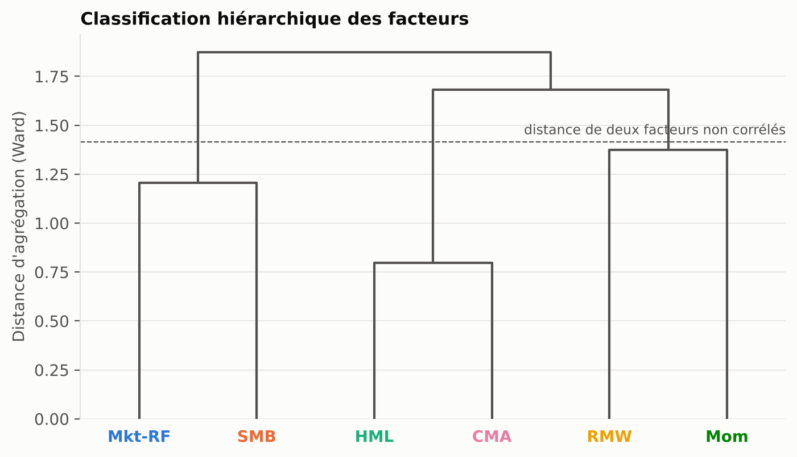

- **HML et CMA fusionnent en premier, à 0,80**, la seule paire nettement sous le seuil d'indépendance ($\sqrt 2$).
- **Mkt-RF et SMB fusionnent à 1,21** : le bloc « directionnel », exposé au risque de marché.
- **RMW et Mom fusionnent à 1,37**, juste sous $\sqrt 2$ : leur corrélation est presque nulle (0,06). Ce regroupement vient surtout de ce qu'ils sont loin des autres, pas de ce qu'ils se ressemblent.
- On retrouve les mêmes familles que dans l'ACP : un bloc marché et taille, un bloc value et investissement, et deux facteurs (rentabilité, momentum) qui évoluent chacun de leur côté.

### 3.7 À retenir de l'étape 3

- La base couvre 758 mois (juillet 1963 à août 2026), sans donnée manquante.
- Cinq primes sur six sont significatives. La taille ne l'est pas.
- Les facteurs ont des rendements à queues épaisses, des pertes maximales longues, et aucun ne gagne à toutes les décennies.
- Leur volatilité et leurs corrélations changent fortement dans le temps.
- Hormis HML et CMA, les facteurs sont peu corrélés entre eux, et l'ACP ne trouve aucune composante dominante : combiner les facteurs diversifie réellement le risque.

## Étape 4 : le modèle explique-t-il les rendements d'une action et d'un portefeuille ?

Code et résultats : [`notebooks/etape4_regression.ipynb`](notebooks/etape4_regression.ipynb).

On estime la régression de l'étape 2 **entre le rendement du mois $t$ et les facteurs du même mois $t$** :

$$
R_{i,t} - R_{f,t} = \alpha_i + \beta_i\,\mathrm{MKT}_t + s_i\,\mathrm{SMB}_t + h_i\,\mathrm{HML}_t + r_i\,\mathrm{RMW}_t + c_i\,\mathrm{CMA}_t + m_i\,\mathrm{MOM}_t + \varepsilon_{i,t}
$$

Le but est explicatif : mesurer quelle part des variations de rendement les facteurs expliquent, pas prévoir le mois suivant. On s'attend à ce que le modèle explique bien un portefeuille diversifié et beaucoup moins bien une action seule.

### 4.1 Données et cibles

- **Période** : janvier 2000 à août 2026, soit 320 mois.
- **Cours** : clôtures mensuelles ajustées des dividendes et des divisions d'actions (Yahoo Finance), téléchargées avec [`scripts/telecharger_cours.py`](scripts/telecharger_cours.py). Rendement du mois : $R_t = P_t/P_{t-1} - 1$.
- **Action seule : Apple (AAPL).** Connue de tous, avec un long historique et un fort risque propre.
- **Portefeuille diversifié : 107 grandes capitalisations américaines** couvrant les 11 secteurs (liste dans [`scripts/univers.py`](scripts/univers.py)), **équipondérées et rééquilibrées chaque mois** : $R_{P,t} = \frac{1}{N}\sum_j R_{j,t}$. Trois titres prévus (BK, MMC, AEP) ont été écartés faute de données.
  - *Équipondéré* : le facteur marché est déjà pondéré par la capitalisation. Un portefeuille pondéré de la même façon serait expliqué presque par construction, ce qui ne testerait rien.
  - *11 secteurs* : les chocs propres à un secteur se compensent.
  - *Plus de 100 titres* : avec $N$ titres indépendants de même risque propre $\sigma_\varepsilon$, la variance spécifique du portefeuille vaut $\sigma_\varepsilon^2/N$ et disparaît quand $N$ grandit.
- **Points de comparaison** : SPY (S&P 500, pondéré par la capitalisation) et RSP (S&P 500 équipondéré, depuis mai 2003).
- **Estimation** : moindres carrés ordinaires, avec des t-stats calculées avec les erreurs standard de Newey-West (6 retards), robustes à l'hétéroscédasticité et à l'autocorrélation des résidus.

### 4.2 Résultats principaux

| | Apple | Portefeuille diversifié | RSP | SPY |
|---|---:|---:|---:|---:|
| **R²** | **37 %** | **94 %** | 96,5 % | 99,4 % |
| R² ajusté | 36 % | 94 % | 96,4 % | 99,4 % |
| R² du CAPM (marché seul) | 30 % | 84 % | 92 % | 98 % |
| Volatilité totale (% par an) | 37,5 | 14,8 | 16,4 | 15,2 |
| Volatilité spécifique (% par an) | 30,1 | 3,7 | 3,1 | 1,2 |
| Alpha (% par an) | 20,9 (t = 3,4) | 2,9 (t = 4,1) | −0,6 (t = −0,9) | −0,2 (t = −1,0) |

Le R² ajusté vaut $1 - (1-R^2)\frac{T-1}{T-k-1}$ avec $k = 6$. La volatilité spécifique vaut $\sqrt{12}\,\hat\sigma_\varepsilon$.

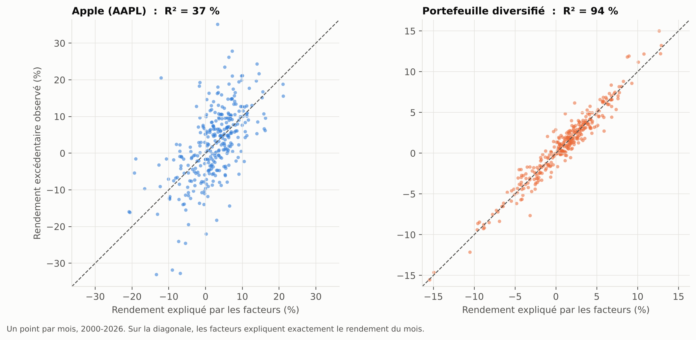

- **Pour Apple, les facteurs n'expliquent que 37 % de la variance.** Les points sont très dispersés autour de la diagonale. La volatilité spécifique (30 % par an) est presque aussi forte que la volatilité totale (37,5 %) : l'essentiel du risque d'Apple tient à Apple elle-même (produits, résultats, annonces).
- **Pour le portefeuille, ils en expliquent 94 %.** Les points collent à la diagonale, et le risque spécifique tombe à 3,7 % par an pour une volatilité totale de 14,8 %. C'est exactement l'idée de l'étape 1 : une fois diversifié, il ne reste presque que le risque des facteurs.
- **Les cinq facteurs ajoutés au marché comptent.** Ils font passer le R² de 84 % à 94 % pour le portefeuille et de 30 % à 37 % pour Apple. Pour SPY, le marché seul explique déjà 98 % : c'est attendu, car SPY et le facteur marché sont deux portefeuilles pondérés par la capitalisation des mêmes grandes actions.
- **L'alpha de SPY et de RSP est nul** (t < 1), ce que le modèle prédit pour un fonds indiciel. Le léger chiffre négatif, non significatif, est de l'ordre des frais de gestion.
- **L'alpha d'Apple et du portefeuille est positif et significatif, mais il ne faut pas le lire comme une surperformance exploitable.** Il vient d'un biais de sélection : Apple a été choisie parce qu'elle est aujourd'hui l'une des plus grandes entreprises du monde, et le portefeuille ne contient que des entreprises toujours cotées en 2026 (biais du survivant). Les entreprises disparues depuis 2000, qui auraient tiré le rendement vers le bas, en sont absentes. Ce biais touche le rendement moyen, donc l'alpha, mais très peu le R².

### 4.3 Les expositions

| | Mkt-RF | SMB | HML | RMW | CMA | Mom |
|---|---:|---:|---:|---:|---:|---:|
| **Apple** | **1,21** (7,9) | 0,25 (1,4) | **−0,57** (−3,2) | 0,25 (1,8) | **−0,67** (−2,2) | −0,03 (−0,2) |
| **Portefeuille** | **0,91** (57,7) | −0,02 (−0,6) | **0,19** (6,2) | **0,15** (6,0) | **0,25** (6,3) | **−0,06** (−4,1) |

*t-stats de Newey-West entre parenthèses, en gras quand |t| > 2.*

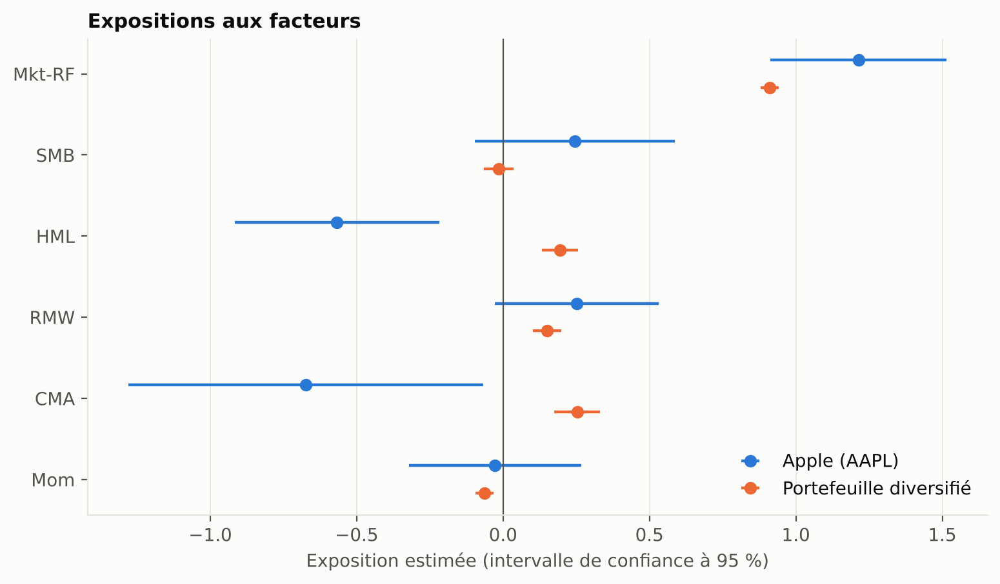

**Apple : une action de croissance plus risquée que le marché.**
- $\beta = 1{,}21$ : quand le marché fait +1 %, Apple fait en moyenne +1,21 %.
- $h = -0{,}57$ et $c = -0{,}67$ : Apple se comporte comme une action chère (« growth ») d'une entreprise qui investit beaucoup, c'est-à-dire à l'opposé des jambes longues de HML et CMA. C'est cohérent avec son profil sur la période : forte croissance, valorisation élevée par rapport aux fonds propres.
- Les intervalles de confiance sont larges : avec autant de risque spécifique, chaque exposition est estimée avec beaucoup d'incertitude.
- Sur tout l'historique depuis 1990 (439 mois), on retrouve les mêmes signes, avec en plus une exposition à la taille ($s = 0{,}34$, t = 2,1) : dans les années 1990, Apple était une entreprise de taille moyenne en difficulté. Le R² tombe à 28 %.

**Le portefeuille : un profil défensif et « qualité ».**
- $\beta = 0{,}91$, mesuré très précisément (t = 58).
- Expositions positives à HML, RMW et CMA : des entreprises établies, rentables et prudentes. L'équipondération donne aussi probablement plus de poids qu'au sein du marché aux secteurs défensifs (consommation de base, santé, services aux collectivités), face aux géants technologiques.
- $s \approx 0$ : ce sont de grandes capitalisations, mais l'équipondération donne autant de poids aux « petites » grandes entreprises qu'aux géants, et les deux effets se compensent.
- **$m = -0{,}06$, une conséquence mécanique de la construction.** Rééquilibrer chaque mois vers des poids égaux revient à vendre ce qui a monté et à racheter ce qui a baissé : c'est l'inverse du momentum. On retrouve le même effet, plus fort, sur RSP ($m = -0{,}10$), alors que SPY, qui ne se rééquilibre pas, n'a quasiment pas d'exposition au momentum.

### 4.4 D'où vient la variance

Avec les coefficients MCO, la variance se décompose exactement :

$$
\mathrm{Var}(y) = \sum_k b_k\,\mathrm{Cov}(F_k, y) + \mathrm{Var}(\varepsilon)
$$

La contribution du facteur $k$ est $b_k\,\mathrm{Cov}(F_k, y)/\mathrm{Var}(y)$. Les contributions des facteurs somment au R² et le reste est la part spécifique. Une contribution peut être légèrement négative quand deux facteurs corrélés se compensent.

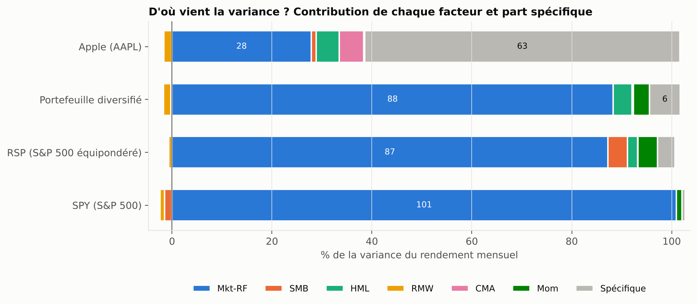

| | Mkt-RF | SMB | HML | RMW | CMA | Mom | Spécifique |
|---|---:|---:|---:|---:|---:|---:|---:|
| Apple | 27,8 | 1,0 | 4,6 | −1,6 | 4,9 | 0,2 | **63,0** |
| Portefeuille diversifié | 88,3 | −0,2 | 3,8 | −1,5 | 0,3 | 3,2 | **6,1** |
| RSP | 87,2 | 3,9 | 2,1 | −0,7 | 0,0 | 3,9 | **3,5** |
| SPY | 100,9 | −1,5 | 0,0 | −0,9 | −0,3 | 1,2 | **0,6** |

*En % de la variance du rendement mensuel.*

- Le marché domine partout. Même pour Apple, c'est le premier facteur, mais il ne pèse que 28 % de la variance contre 63 % pour la part spécifique.
- Pour le portefeuille, les facteurs de style (HML, Mom) ajoutent environ 7 points au marché, et la part spécifique n'est plus que de 6 %.

### 4.5 Le R² en fonction du nombre d'actions

On tire au hasard $N$ actions parmi les 107, on forme le portefeuille équipondéré et on calcule le R². On répète 300 fois pour chaque $N$.

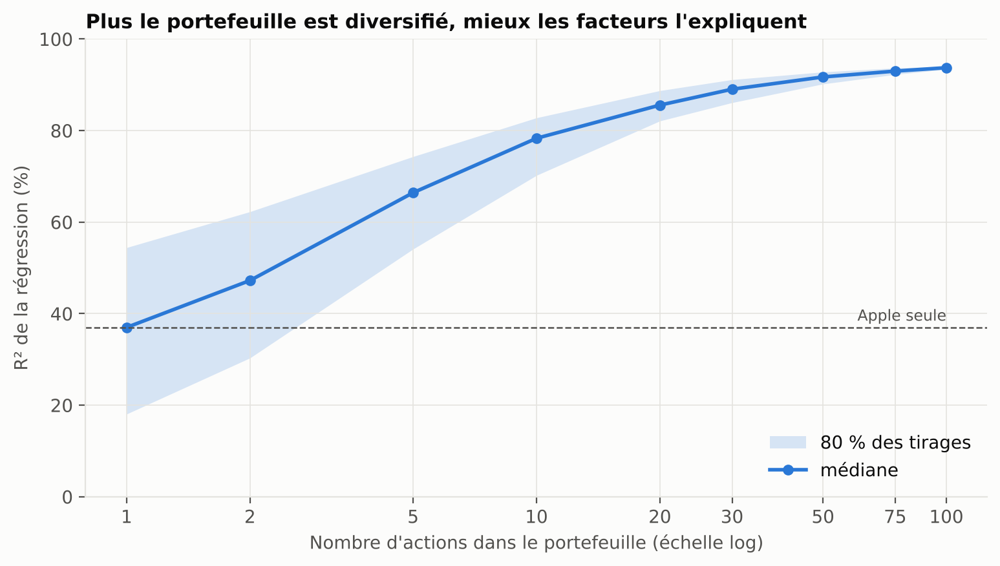

| Nombre d'actions | 1 | 2 | 5 | 10 | 20 | 30 | 50 | 100 |
|---|---:|---:|---:|---:|---:|---:|---:|---:|
| R² médian | 37 % | 47 % | 66 % | 78 % | 86 % | 89 % | 92 % | 94 % |
| 80 % des tirages entre | 18 et 54 % | 30 et 62 % | 54 et 74 % | 70 et 83 % | 82 et 89 % | 86 et 91 % | 90 et 93 % | 93 et 94 % |

- **Apple est une action typique** : son R² (37 %) est égal à la médiane des actions prises seules.
- **La diversification fait l'essentiel du travail très vite.** On passe de 37 % à 78 % avec 10 actions, et à 89 % avec 30. Au-delà, le gain ralentit fortement : c'est la décroissance en $1/N$ de la variance spécifique.
- **Le R² plafonne vers 94 %.** Une petite part de la variance reste inexpliquée même avec 100 titres. Elle vient probablement de chocs sectoriels (pétrole, banques, technologie) qui ne correspondent à aucun des six facteurs, et que l'équipondération pèse différemment du marché.

### 4.6 Stabilité dans le temps

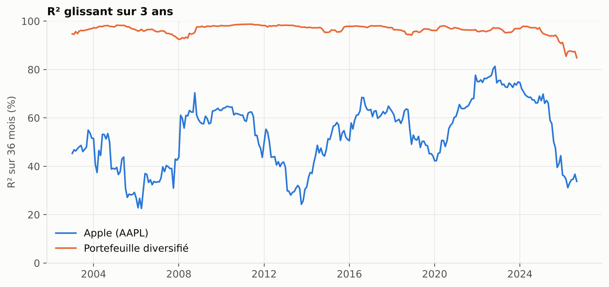

- Le R² d'Apple varie fortement, de 23 % (2006) à 81 % (2022). Pendant les crises (2008, 2020-2022), toutes les actions bougent ensemble avec le marché et le R² monte. En période calme, ce sont les nouvelles propres à Apple qui dominent.
- Le R² du portefeuille reste entre 92 et 99 % jusqu'en 2024, puis baisse à 85 % fin 2026. Hypothèse, non testée ici : le marché pondéré par la capitalisation est de plus en plus concentré sur quelques géants technologiques, et un portefeuille équipondéré s'en écarte davantage.

### 4.7 Diagnostic des résidus

| | Apple | Portefeuille | RSP | SPY |
|---|---:|---:|---:|---:|
| Durbin-Watson | 1,97 | 1,91 | 1,85 | 2,27 |
| Kurtosis des résidus | 6,7 | 4,8 | 4,8 | 7,7 |
| p-valeur Jarque-Bera | < 0,001 | < 0,001 | < 0,001 | < 0,001 |
| p-valeur Breusch-Pagan | 0,010 | 0,715 | 0,268 | 0,005 |

- **Pas d'autocorrélation** : les statistiques de Durbin-Watson sont proches de 2.
- **Résidus non normaux** : ils ont des queues épaisses (kurtosis de 4,8 à 7,7, contre 3 pour une loi normale).
- **Hétéroscédasticité** pour Apple et SPY : la variance des résidus dépend des facteurs.
- Ces écarts ne biaisent pas les coefficients, mais ils faussent les erreurs standard classiques. C'est pourquoi les t-stats sont calculées avec Newey-West.

### 4.8 À retenir de l'étape 4

- Le modèle à six facteurs explique **94 % de la variance d'un portefeuille diversifié** de 107 actions, mais **seulement 37 % de celle d'Apple**.
- La différence est le risque spécifique : 63 % de la variance d'Apple, 6 % de celle du portefeuille. Il disparaît avec la diversification, et dès 30 actions le R² dépasse 89 %.
- Les facteurs de style apportent une information réelle au-delà du marché : 10 points de R² en plus pour le portefeuille.
- Les expositions estimées ont un sens économique : Apple est une valeur de croissance à bêta élevé, le portefeuille équipondéré est défensif et légèrement anti-momentum, par construction.
- Conclusion pour la suite : ce qui reste dans un portefeuille diversifié, c'est le risque des facteurs. C'est donc entre ces facteurs qu'il faut répartir le risque.

## Étape 5 : faut-il regarder le lien entre facteurs et rendements de façon non linéaire ?

Code et résultats : [`notebooks/etape5_information_mutuelle.ipynb`](notebooks/etape5_information_mutuelle.ipynb).

La régression de l'étape 4 suppose un lien **linéaire** entre facteurs et rendements. On se demande si une mesure qui capte aussi les liens non linéaires, l'**information mutuelle**, révèle quelque chose que la corrélation de Pearson ne voit pas. Mêmes cibles (Apple et le portefeuille diversifié), même période (2000-2026, 320 mois), même lien contemporain (mois $t$ contre mois $t$).

### 5.1 Les deux mesures

**Corrélation de Pearson.** Elle mesure l'intensité d'un lien linéaire :

$$\rho_{XY} = \frac{\mathrm{Cov}(X,Y)}{\sigma_X\,\sigma_Y} \in [-1, 1]$$

Une corrélation nulle ne veut pas dire absence de lien : si $X$ est centré symétrique et $Y = X^2$, $Y$ dépend entièrement de $X$ et pourtant $\rho_{XY} = 0$.

**Information mutuelle.** Elle compare la loi jointe du couple à ce qu'elle serait si $X$ et $Y$ étaient indépendants :

$$I(X;Y) = \iint p(x,y)\,\ln\frac{p(x,y)}{p(x)\,p(y)}\,dx\,dy \;\ge 0$$

Elle vaut 0 **si et seulement si** $X$ et $Y$ sont indépendants, quelle que soit la forme du lien. Elle n'a pas de signe et s'exprime en *nats*.

**Pour comparer les deux sur la même échelle.** Pour un couple gaussien de corrélation $\rho$, $I = -\tfrac12\ln(1-\rho^2)$. On en tire la **corrélation équivalente** $\rho_I = \sqrt{1-e^{-2I}}$ (Linfoot, 1957), comprise entre 0 et 1. Si le lien est linéaire et gaussien, $\rho_I = |\rho|$. Si $\rho_I$ dépasse nettement $|\rho|$, l'information mutuelle voit un lien que la corrélation ne voit pas.

### 5.2 Les deux tests de significativité

| | Corrélation de Pearson | Information mutuelle |
|---|---|---|
| Hypothèse testée | $\rho = 0$ (pas de lien linéaire) | $I = 0$ (indépendance totale) |
| Statistique | $t = \hat\rho\sqrt{T-2}\,/\sqrt{1-\hat\rho^2}$, loi de Student à $T-2$ degrés de liberté | estimateur des plus proches voisins de Kraskov et al. (2004), $k = 5$ |
| Loi sous l'hypothèse | connue | obtenue par **permutation** : on mélange 5 000 fois l'ordre des mois de $Y$, ce qui casse tout lien avec $X$ |
| Seuil à 5 % pour $T = 320$ | $\lvert\hat\rho\rvert > 0{,}11$ | $\hat I > 0{,}050$ nat, soit $\rho_I > 0{,}31$ |

Avant d'estimer l'information mutuelle, chaque variable est remplacée par ses scores normaux $\Phi^{-1}\big(\text{rang}/(T+1)\big)$. L'information mutuelle ne change pas quand on transforme une variable de façon croissante : on ne perd rien, et l'estimateur devient moins sensible aux mois extrêmes.

La dernière ligne du tableau résume déjà le problème : **pour être jugé significatif, un lien doit être presque trois fois plus fort avec l'information mutuelle qu'avec Pearson.**

### 5.3 Résultats, facteur par facteur

| Facteur | Apple : $\rho$ | Apple : $\rho_I$ | Portefeuille : $\rho$ | Portefeuille : $\rho_I$ |
|---|---:|---:|---:|---:|
| Mkt-RF | **0,55** | **0,62** | **0,91** | **0,95** |
| SMB | **0,15** | 0,21 | **0,22** | 0,06 |
| HML | **−0,26** | **0,35** | **0,24** | 0,25 |
| RMW | **−0,23** | 0,00 | **−0,14** | **0,36** |
| CMA | **−0,35** | **0,32** | 0,02 | 0,17 |
| Mom | **−0,16** | 0,00 | **−0,43** | **0,42** |

En gras : significatif à 5 %. P-valeurs détaillées dans le notebook.

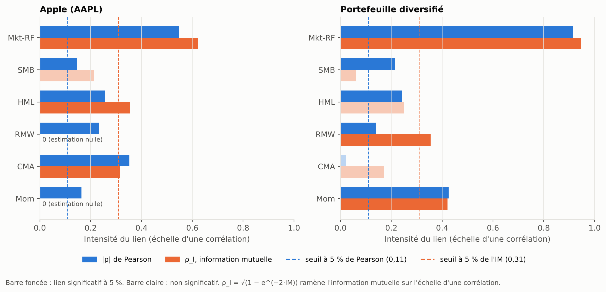

- **Pearson détecte 11 liens sur 12, l'information mutuelle 6.** Les 6 liens détectés par l'information mutuelle sont tous détectés par Pearson. Elle ne trouve **aucun lien que Pearson aurait manqué**.
- **Les liens forts sont vus par les deux mesures** : le marché pour les deux cibles, le momentum pour le portefeuille, HML et CMA pour Apple. Pour le marché, $\rho_I$ est proche de $|\rho|$ : le lien est essentiellement linéaire.
- **Les liens faibles (|ρ| entre 0,15 et 0,24) échappent à l'information mutuelle**, alors qu'ils sont nets pour Pearson (p-valeurs toutes inférieures à 0,01). Deux estimations valent même exactement 0 pour Apple (RMW et Mom), bien que $|\rho|$ dépasse 0,16.
- **Deux couples ont un $\rho_I$ nettement au-dessus de $|\rho|$** : HML-Apple (0,35 contre 0,26) et RMW-portefeuille (0,36 contre 0,14). La partie 5.5 montre que ce surplus n'est pas significatif et ne laisse aucune trace une fois la régression estimée.
- **Les valeurs faibles de l'information mutuelle sont instables** : selon le nombre de voisins $k$ (3, 5, 10 ou 20), l'estimation pour HML-Apple varie de 0,01 à 0,08 nat. Les valeurs fortes (marché) ne bougent presque pas.

### 5.4 Pourquoi les deux tests ne concluent pas pareil : la puissance

La **puissance** d'un test est la probabilité de détecter un lien qui existe vraiment. On la mesure par simulation, avec 320 observations comme dans nos données, dans deux cas : un lien linéaire, terrain de Pearson, et un lien en U ($Y = a(X^2-1) + \text{bruit}$, corrélation nulle), terrain de l'information mutuelle.

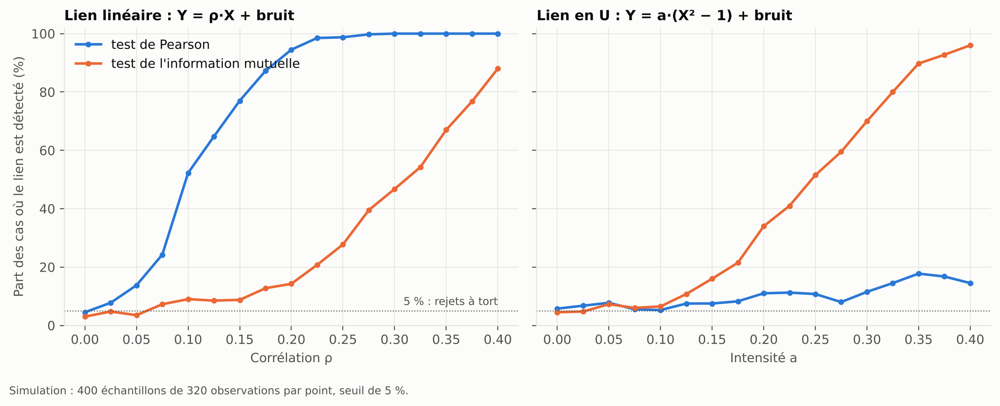

- **Lien linéaire** : pour $\rho = 0{,}2$, Pearson détecte le lien 94 fois sur 100, l'information mutuelle 14 fois sur 100. C'est exactement l'ordre de grandeur des liens de style observés.
- **Lien en U** : la situation s'inverse. Pour $a = 0{,}3$, l'information mutuelle détecte le lien 70 fois sur 100, Pearson 12 fois sur 100.
- **C'est le prix de la généralité.** Pearson ne cherche qu'une seule forme de lien et concentre toute l'information de l'échantillon sur elle. L'information mutuelle cherche toutes les formes possibles et a besoin de beaucoup plus de données pour en confirmer une. Avec 320 mois, elle ne voit que les liens forts.

Conclusion intermédiaire : quand l'information mutuelle n'est pas significative et Pearson l'est, ce n'est pas un désaccord sur l'existence du lien, c'est un manque de puissance.

### 5.5 Reste-t-il un lien non linéaire ?

La comparaison précédente ne dit pas si le lien a une composante non linéaire. Trois tests y répondent directement.

**1. Les nuages de points.** Pour chaque facteur, on trace la droite de régression simple et une courbe lissée (LOWESS), qui suit les données sans imposer de forme.

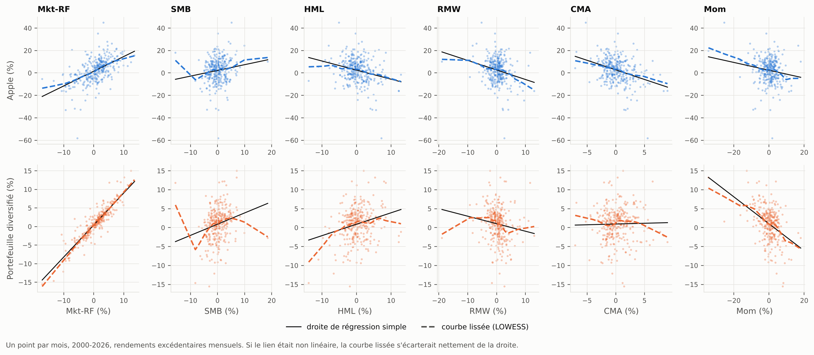

La courbe lissée suit la droite dans la zone où se trouvent presque tous les mois. Elle ne s'en écarte qu'aux extrémités, là où il n'y a que quelques points : ces écarts viennent de quelques mois isolés, pas d'une forme non linéaire.

**2. L'information mutuelle comparée au cas gaussien.** Si le lien était linéaire et gaussien, l'information mutuelle vaudrait $-\tfrac12\ln(1-\rho^2)$. On simule 1 000 échantillons gaussiens de 320 mois avec la même corrélation et on regarde si l'information mutuelle observée dépasse ce qu'on obtient par simulation.
- Un seul couple sur 12 dépasse significativement le cas gaussien : **marché et portefeuille** (1,12 nat contre 0,91 attendu, p = 0,001). HML-Apple et RMW-portefeuille restent compatibles avec lui (p = 0,11 et 0,08).
- Ce surplus ne vient pas d'une courbe : la régression linéaire laisse des résidus indépendants du marché (test 3 ci-dessous). Il vient de la forme de la loi jointe : les deux variables évoluent encore plus ensemble lors des mois extrêmes qu'une loi normale ne le prévoit, ce qui est typique des krachs où tout baisse en même temps.

**3. Les résidus de la régression.** Une fois la régression de l'étape 4 estimée, ses résidus ne sont plus du tout corrélés aux facteurs (c'est une propriété des moindres carrés). Toute information mutuelle entre résidus et facteurs serait donc non linéaire.

| | Apple | Portefeuille |
|---|---:|---:|
| Couples résidus-facteur significatifs à 5 % | 0 sur 6 | 2 sur 6 (HML et Mom, p ≈ 0,01) |
| Significatifs après correction des tests multiples (seuil $0{,}05/12$) | 0 | 0 |
| R² ajusté, modèle linéaire | 35,8 % | 93,8 % |
| R² ajusté, en ajoutant les carrés des six facteurs | 36,0 % | 93,8 % |
| p-valeur du test joint des six carrés (Wald, Newey-West) | 0,08 | 0,18 |

- Ajouter les carrés des facteurs à la régression **ne change pratiquement rien** : +0,2 point de R² ajusté pour Apple, rien pour le portefeuille, et les carrés ne sont pas significatifs ensemble.
- Les deux signaux résiduels du portefeuille ne résistent pas à la correction des tests multiples. Faire 12 tests au seuil de 5 % produit en moyenne 0,6 faux positif. Ils traduisent en plus une dépendance de la **dispersion** et non du niveau : les écarts au modèle sont plus grands les mois où HML bouge fortement (corrélation de rang de 0,24 entre $|\text{HML}|$ et $|\hat\varepsilon|$). Cela ne permettrait pas de mieux expliquer le rendement.

### 5.6 À retenir de l'étape 5

- **Pour expliquer les rendements par les facteurs, la lecture non linéaire n'apporte rien de mesurable ici.** L'information mutuelle ne trouve aucun lien que Pearson aurait manqué, et ajouter des termes non linéaires à la régression n'améliore pas le R².
- **Avec 320 mois, l'information mutuelle est beaucoup moins puissante.** Elle ne juge significatif qu'un lien d'une force équivalente à $\rho > 0{,}31$, contre $0{,}11$ pour Pearson. Elle passe à côté de liens linéaires faibles, mais bien réels, comme ceux de SMB ou RMW.
- **Elle reste utile comme diagnostic.** Elle confirme que le modèle linéaire suffit, et elle signale ce que la corrélation ne voit pas. Le marché et le portefeuille chutent ensemble plus souvent qu'une loi normale ne le prévoit, et la dispersion des écarts au modèle varie avec les facteurs. Ces deux points concernent le **risque**, pas le rendement moyen.

## Étape 6 : les expositions aux facteurs sont-elles stables dans le temps ?

Code et résultats : [`notebooks/etape6_stabilite_expositions.ipynb`](notebooks/etape6_stabilite_expositions.ipynb).

La régression de l'étape 4 a été estimée une seule fois sur 2000-2026, ce qui suppose des expositions (les bêtas) constantes pendant 26 ans. Pour vérifier cette hypothèse, on ré-estime la même régression, sur les mêmes cibles (Apple et le portefeuille diversifié), période par période et régime par régime. On teste ensuite si les écarts dépassent ce que le bruit statistique suffit à produire.

### 6.1 Périodes et régimes de marché

**Quatre sous-périodes**, de 72 à 84 mois chacune, soit plus de dix mois par coefficient estimé :

| Période | Contexte |
|---|---|
| 2000-2006 | éclatement de la bulle internet, puis reprise |
| 2007-2012 | crise financière, puis crise des dettes souveraines en zone euro |
| 2013-2019 | expansion longue et peu volatile, taux bas |
| 2020-2026 | Covid, inflation et hausse des taux, essor de l'IA |

**Deux régimes de volatilité.** Chaque mois, on calcule la volatilité du marché sur les 12 mois précédents. Au-dessus de sa médiane (14,1 % par an), le mois est classé en « volatilité forte », sinon en « volatilité faible ». Cela donne 160 mois de chaque type, qui regroupent des mois éloignés dans le temps mais pris dans un même climat de marché.

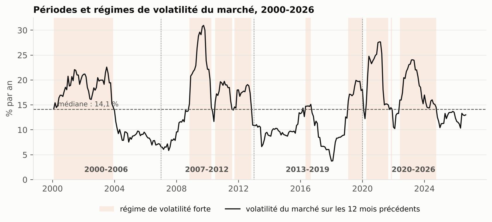

### 6.2 Les expositions période par période

| | 2000-2026 | 2000-2006 | 2007-2012 | 2013-2019 | 2020-2026 | p-valeur |
|---|---:|---:|---:|---:|---:|---:|
| **Apple** : Mkt-RF | 1,21 | 1,37 | 1,47 | 1,01 | 1,12 | 0,47 |
| SMB | 0,25 | 0,68 | −0,02 | 0,04 | −0,15 | 0,34 |
| HML | −0,57 | 0,25 | −0,98 | −0,06 | −0,59 | 0,10 |
| RMW | 0,25 | 0,02 | 0,06 | **1,77** | 0,28 | **0,01** |
| CMA | −0,67 | −2,15 | −0,99 | −1,93 | **0,32** | **< 0,001** |
| Mom | −0,03 | −0,03 | 0,02 | −0,09 | −0,19 | 0,87 |
| R² | 37 % | 40 % | 50 % | 45 % | 59 % | |
| **Portefeuille** : Mkt-RF | 0,91 | 0,95 | 0,93 | 0,97 | 0,88 | 0,05 |
| SMB | −0,02 | 0,01 | −0,08 | −0,04 | 0,04 | 0,34 |
| HML | 0,19 | 0,15 | 0,18 | **−0,03** | 0,26 | **< 0,001** |
| RMW | 0,15 | 0,23 | 0,12 | 0,07 | 0,12 | 0,17 |
| CMA | 0,25 | 0,26 | **0,04** | 0,36 | 0,30 | **< 0,001** |
| Mom | −0,06 | −0,10 | −0,06 | −0,01 | −0,05 | 0,04 |
| R² | 94 % | 93 % | 98 % | 97 % | 93 % | |

**Comment lire la p-valeur.** On estime un seul modèle dans lequel chaque coefficient peut prendre une valeur différente dans chaque période, puis on teste si ces valeurs sont égales (test de Chow, sous forme de test de Wald avec les erreurs standard de Newey-West). Une p-valeur faible signifie que l'exposition change vraiment d'une période à l'autre. Le test joint des six expositions rejette la stabilité pour les deux cibles (p < 0,001).

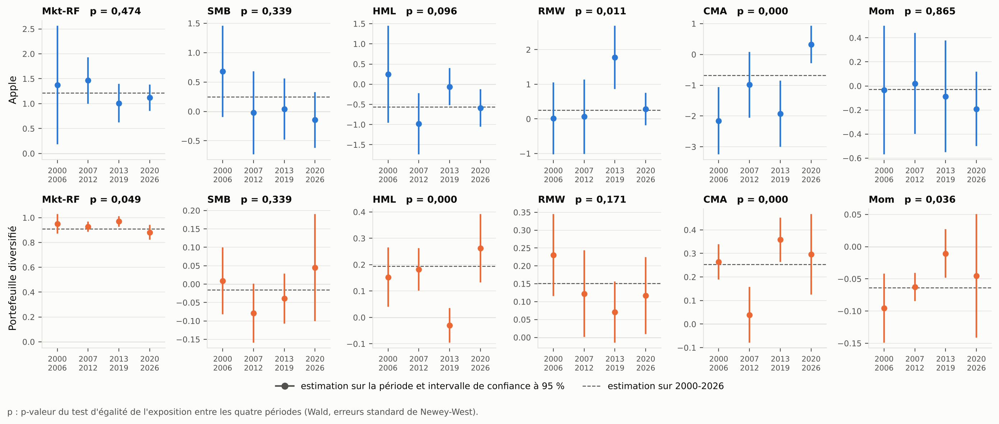

**Apple : le bêta de marché paraît bouger, mais rien ne le prouve. Le profil de style, lui, suit la transformation de l'entreprise.**
- Le bêta de marché va de 1,01 à 1,47, mais les intervalles de confiance se recouvrent largement et le test ne rejette pas l'égalité (p = 0,47). Sur 80 mois d'une action aussi volatile, un écart de 0,5 reste dans le bruit d'estimation.
- **CMA passe de −2,15 à +0,32** (p < 0,001). Lecture économique probable : en 2000-2006, Apple est une entreprise moyenne en pleine expansion (iPod, magasins), qui fait croître son actif très vite : c'est le profil « investissement agressif ». En 2020-2026, elle rachète massivement ses propres actions, ce qui freine la croissance de son actif : elle ressemble alors à une entreprise à « investissement conservateur ».
- **RMW monte à 1,77 en 2013-2019** (p = 0,01) : c'est la période où les marges de l'iPhone font d'Apple l'une des entreprises les plus rentables au monde.
- SMB vaut +0,68 en 2000-2006, quand Apple était encore une capitalisation moyenne, puis devient nul ou négatif. Le test n'est pas significatif, mais le sens économique est clair.

**Portefeuille : le bêta de marché est stable, certaines expositions de style le sont moins.**
- Le bêta de marché reste entre 0,88 et 0,97. Le test est à la limite du seuil (p = 0,05), mais l'écart est faible en valeur.
- **HML tombe à −0,03 en 2013-2019**, contre 0,15 à 0,26 dans les autres périodes. **CMA tombe à 0,04 en 2007-2012**, contre 0,26 à 0,36 ailleurs. Une explication plausible : la composition des secteurs « value » change d'une décennie à l'autre (banques et énergie en crise, puis fortes hausses des valeurs de croissance en 2013-2019), alors que les poids du portefeuille restent fixes.

### 6.3 Régimes de volatilité

| | Apple, vol. faible | Apple, vol. forte | p-valeur | Portefeuille, vol. faible | Portefeuille, vol. forte | p-valeur |
|---|---:|---:|---:|---:|---:|---:|
| Mkt-RF | 1,45 | 1,15 | 0,41 | 0,92 | 0,89 | 0,36 |
| HML | −0,08 | −0,69 | 0,15 | 0,15 | 0,21 | 0,45 |
| RMW | 0,95 | 0,13 | 0,01 | 0,19 | 0,13 | 0,32 |
| CMA | −0,82 | −0,56 | 0,65 | 0,28 | 0,27 | 0,89 |
| Mom | 0,37 | −0,11 | 0,13 | −0,01 | −0,09 | 0,01 |
| R² | 31 % | 45 % | | 90 % | 96 % | |
| Test joint des six expositions | | | 0,05 | | | 0,008 |

SMB, qui ne change significativement pour aucune des deux cibles, est dans le notebook.

- **Le bêta de marché ne change pas avec la volatilité**, ni pour Apple ni pour le portefeuille.
- **Les différences sont bien plus faibles qu'entre périodes.** Ce qui fait bouger les expositions, c'est surtout l'époque, avec ses secteurs dominants et la vie des entreprises, plus que le niveau de stress du marché.
- **Le portefeuille est plus anti-momentum en période agitée** (−0,09 contre −0,01, p = 0,01). C'est cohérent avec l'étape 4 : le rééquilibrement mensuel vend ce qui a monté et achète ce qui a baissé. Cet effet pèse plus quand les écarts de performance entre titres sont grands, donc quand le marché est agité.
- **Le R² est plus élevé quand la volatilité est forte** (96 % contre 90 % pour le portefeuille, 45 % contre 31 % pour Apple). En période de stress, les chocs communs dominent les nouvelles propres à chaque entreprise.

### 6.4 Bêtas glissants : variation réelle ou bruit d'estimation ?

On ré-estime la régression sur chaque fenêtre de 36 mois. Un bêta glissant bouge toujours un peu, même si le vrai bêta est constant. Pour mesurer ce bruit, on simule 500 historiques dans lesquels les bêtas sont **constants** (égaux à l'estimation 2000-2026). Leurs résidus sont tirés par blocs de 12 mois parmi les vrais résidus. La bande grise contient 90 % des bêtas glissants simulés. Si les vrais bêtas étaient constants, le bêta observé en sortirait environ 10 % du temps.

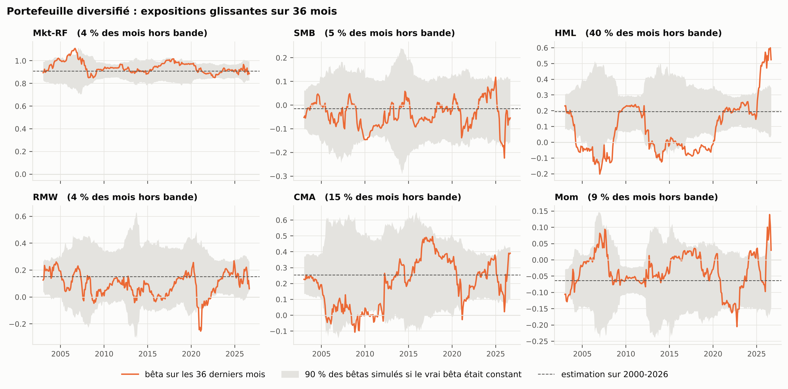

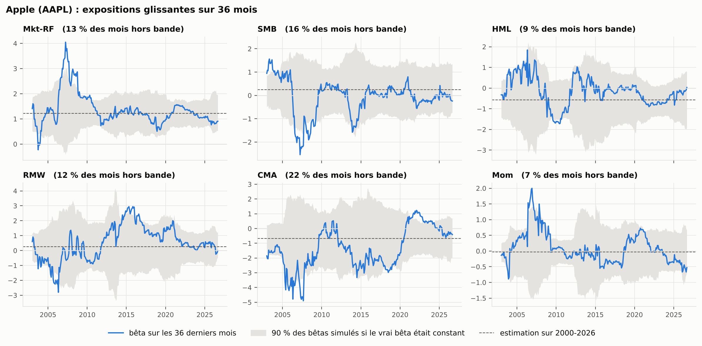

| Part des mois hors de la bande (10 % attendus si les bêtas sont constants) | Mkt-RF | SMB | HML | RMW | CMA | Mom |
|---|---:|---:|---:|---:|---:|---:|
| Apple | 13 % | 16 % | 9 % | 12 % | **22 %** | 7 % |
| Portefeuille | 4 % | 5 % | **40 %** | 4 % | **15 %** | 9 % |

- **Pour le portefeuille, le bêta de marché reste dans la bande presque tout le temps** : sa variation est entièrement compatible avec le bruit. **HML en sort 40 % du temps.** Il passe de +0,2 à −0,2 au milieu des années 2000, reste près de 0 entre 2012 et 2020, puis monte à +0,55 sur les trois dernières années.
- **Pour Apple, les bandes sont très larges**, car le risque spécifique est énorme (30 % par an). La plupart des mouvements, même spectaculaires, restent dans le bruit. Seul CMA en sort nettement plus souvent que prévu, ce qui confirme le basculement vu en 6.2. Le pic du bêta de marché vers 4 en 2007 sort de la bande, mais il est isolé.

### 6.5 L'instabilité compte-t-elle en pratique ?

On compare l'écart de suivi, c'est-à-dire la volatilité annualisée de la partie non expliquée, dans deux cas : avec les bêtas estimés une fois sur 2000-2026, et avec les bêtas ré-estimés dans chaque période. On corrige du nombre de coefficients (7 contre 28), comme pour un $R^2$ ajusté.

| | Bêtas constants | Bêtas par période | Baisse |
|---|---:|---:|---:|
| Apple | 30,1 % | 29,0 % | −3,5 % |
| Portefeuille | 3,7 % | 3,4 % | −7,4 % |

Laisser les bêtas changer améliore l'explication, mais peu : l'essentiel du lien entre facteurs et rendements est capté par des bêtas constants.

### 6.6 À retenir de l'étape 6

- **Les bêtas ne sont pas parfaitement stables** : pour les deux cibles, le test joint rejette l'égalité des expositions entre les quatre périodes (p < 0,001).
- **Ce qui est stable, c'est le bêta de marché d'un portefeuille diversifié** : entre 0,88 et 0,97 sur toutes les périodes et dans les deux régimes, et toujours dans la bande du bruit d'estimation.
- **Ce qui bouge, ce sont certaines expositions de style** : HML et CMA pour le portefeuille, CMA et RMW pour Apple. Elles changent d'une époque à l'autre bien plus qu'entre marchés calmes et agités. Pour une action seule, elles suivent la vie de l'entreprise : Apple est passée d'une entreprise moyenne en forte croissance à un géant très rentable qui rachète ses actions.
- **Une bonne partie de la variation apparente n'est que du bruit.** Sur 36 mois, un bêta glissant peut bouger beaucoup sans que le vrai bêta change. Il faut donc tester avant de conclure, d'autant qu'on fait ici de nombreux tests.
- **Pour la partie allocation à venir** : les expositions doivent être ré-estimées régulièrement plutôt que fixées une fois pour toutes. Comme leurs variations sont lentes et en partie dues au bruit, il vaut mieux ne pas réagir à chaque mouvement de court terme.

## Étape 7 : comment fonctionne l'allocation par facteurs ?

Les étapes 2 à 6 ont décrit les facteurs et montré ce qu'ils expliquent. On passe maintenant à la gestion de portefeuille : comment investir **à travers** les facteurs. Cette étape ne contient pas de code. Elle explique la méthode qui sera ensuite reproduite et testée.

### 7.1 Ce que les étapes précédentes nous apprennent

- **Un portefeuille diversifié, c'est un panier de facteurs** (étape 4) : 94 % de sa variance vient des six facteurs. Gérer un portefeuille diversifié revient donc à choisir combien de risque on prend sur chaque facteur.
- **Les rendements futurs des facteurs ne se prévoient pas, leur risque si** (étape 1). Une allocation solide doit reposer sur le risque, pas sur des paris de rendement.
- **Les facteurs ont des risques très différents** (étape 3) : le marché et le momentum ont une volatilité de 15 % par an, CMA et RMW de 7 à 8 %. Leurs volatilités et leurs corrélations changent dans le temps.
- **Certains facteurs se ressemblent** (étape 3) : HML et CMA sont corrélés à 0,68. Les autres le sont peu, donc les combiner diversifie vraiment.
- **Les expositions bougent lentement** (étape 6) : il faut ré-estimer et rééquilibrer régulièrement, sans réagir à chaque mouvement de court terme.

### 7.2 Le principe : une allocation à deux étages

Investir par facteurs, c'est répondre à deux questions, dans cet ordre :

1. **Étage 1, construire chaque facteur.** Quelles actions acheter pour être exposé à la value, au momentum, à la qualité... ? C'est le rôle des **z-scores**.
2. **Étage 2, répartir entre les facteurs.** Combien mettre dans chaque facteur ? C'est le rôle de l'**équipondération** ou de l'**ERC**.

Une analogie : l'étage 1 compose six équipes, une par facteur, en choisissant les meilleurs joueurs pour chaque poste. L'étage 2 décide du temps de jeu de chaque équipe.

C'est la démarche décrite par Roncalli (2017) et appliquée dans la gamme Dynamic Multi Factors d'Amundi (étape 1). Les primes de risque sont d'abord construites une par une. Elles sont ensuite assemblées en répartissant le **risque**, et non le capital.

### 7.3 Étage 1 : construire un facteur avec les z-scores

#### Quelles actions ?

On part d'un **univers d'investissement**, c'est-à-dire la liste des actions dans lesquelles on s'autorise à investir. On le choisit selon trois critères :

- **Être investissable** : seules les actions assez grandes et assez échangées pour être achetées sans faire bouger le prix. En pratique, ce sont les grandes et moyennes capitalisations d'un indice large (S&P 500, Russell 1000, MSCI USA).
- **Avoir les données** : il faut le cours et les comptes de l'entreprise (fonds propres, bénéfices, actifs) pour mesurer chaque caractéristique.
- **Être assez nombreuses** : il faut des centaines de titres pour que chaque facteur soit lui-même diversifié. L'étape 4 l'a montré : en dessous de 30 actions, le risque propre des titres pèse encore lourd.

#### Quelle caractéristique pour chaque facteur ?

On mesure, pour chaque action, la caractéristique que la prime rémunère. Ce sont les mêmes mesures qu'à l'étape 2.5 :

| Facteur | Caractéristique mesurée | On préfère les actions... |
|---|---|---|
| Taille (SMB) | capitalisation boursière | les plus **petites** |
| Value (HML) | fonds propres / capitalisation | les moins chères en bourse par rapport à leurs **fonds propres** |
| Rentabilité (RMW) | bénéfice d'exploitation / fonds propres | les plus **rentables** |
| Investissement (CMA) | croissance de l'actif sur un an | celles qui investissent **le moins** |
| Momentum (Mom) | rendement des 12 derniers mois, sans le dernier | celles qui ont **le plus monté** |

Le marché n'a pas de z-score : il correspond à toutes les actions, pondérées par leur capitalisation.

#### Calculer le z-score

Ces caractéristiques ne sont pas comparables entre elles : un ratio de 0,8, une croissance d'actif de 12 % et une hausse de 30 % ne se lisent pas sur la même échelle. Le z-score les met toutes sur une échelle commune. Il mesure **de combien d'écarts-types une action s'écarte de la moyenne des autres actions, à la même date** :

$$z_i = \frac{x_i - \bar x}{\sigma_x}$$

- $x_i$ est la caractéristique de l'action $i$.
- $\bar x$ et $\sigma_x$ sont la moyenne et l'écart-type de cette caractéristique **sur toutes les actions de l'univers, au même mois**. On compare les actions entre elles à un instant donné, pas une action à son propre passé.
- On met le signe pour que **plus haut = plus désirable**. Pour l'investissement ou la taille, où l'on préfère les petites valeurs, on prend $-z$.

**Exemple** avec cinq actions et le ratio fonds propres / capitalisation (facteur value) :

| Action | Ratio $x_i$ | $x_i - \bar x$ | z-score |
|---|---:|---:|---:|
| A | 0,20 | −0,40 | −1,05 |
| B | 0,40 | −0,20 | −0,53 |
| C | 0,50 | −0,10 | −0,26 |
| D | 0,70 | +0,10 | +0,26 |
| E | 1,20 | +0,60 | +1,58 |

Moyenne $\bar x = 0{,}60$, écart-type $\sigma_x = 0{,}38$. L'action E est la plus « value » : son ratio est 1,58 écart-type au-dessus de la moyenne. L'action A est la plus « croissance ».

**Le lien avec Fama et French.** À l'étape 2.5, Fama et French classent les actions en groupes : les 30 % les moins chères, les 30 % les plus chères. Ce classement n'utilise que le **rang** de l'action. Le z-score va plus loin : il dit aussi **à quelle distance** l'action est des autres. Une action « très value » pèse alors plus qu'une action « un peu value ».

#### Nettoyer avant de classer

- **Écrêter les extrêmes** : une seule valeur aberrante (une donnée comptable erronée, une entreprise en faillite) gonfle l'écart-type et écrase tous les autres scores. On plafonne donc les z-scores, souvent à ±3.
- **Comparer à l'intérieur de chaque secteur** : une banque a presque toujours un ratio fonds propres / capitalisation plus élevé qu'une entreprise de logiciels. Sans précaution, le facteur value deviendrait un pari « banques contre technologie ». On calcule donc souvent le z-score au sein de chaque secteur (moyenne et écart-type du secteur), pour comparer une banque aux autres banques.
- **Combiner plusieurs mesures** : un seul ratio est fragile. Pour la value, on fait souvent la moyenne des z-scores de plusieurs ratios (fonds propres, bénéfices, flux de trésorerie, chacun rapporté à la capitalisation), puis on re-standardise.

#### Quelles actions privilégier, et pourquoi ?

- **On classe les actions par z-score décroissant et on privilégie les plus élevés.** Un z-score élevé signifie que l'action porte fortement la caractéristique rémunérée par la prime (étape 2). C'est elle qui donnera au portefeuille la plus forte exposition au facteur.
- **Version long-only**, celle des fonds : on achète par exemple les 20 à 30 % d'actions au meilleur score.
- **Version long-short**, celle de Fama et French : on achète les meilleurs scores et on vend à découvert les moins bons. Le rendement du facteur est l'écart entre les deux paniers.
- **Pondérer à l'intérieur du facteur**, trois choix courants :
  - poids égaux entre les actions retenues : simple, mais favorise les petites capitalisations ;
  - poids proportionnels à la capitalisation : facile à investir, mais concentré sur quelques géants ;
  - poids inclinés par le score, par exemple $w_i \propto \text{capitalisation}_i \times (1 + z_i)$ : l'action garde sa taille de départ, augmentée si son score est bon.
- **Limiter la rotation** : on rééquilibre à date fixe (chaque année pour les ratios comptables, chaque mois pour le momentum). On ne vend une action que si son score est nettement retombé, par exemple sous les 40 % meilleurs alors qu'on l'avait achetée dans les 20 % meilleurs. Cette zone tampon évite d'acheter et de revendre une action pour une variation de score infime, ce qui coûte en frais.

#### Assembler plusieurs facteurs : deux voies

- **Voie « mix »** : on construit un portefeuille par facteur, puis on les assemble. On contrôle ainsi exactement le poids et le risque de chaque facteur. C'est cette voie qui permet l'étage 2.
- **Voie « intégrée »** : on calcule pour chaque action un score global, moyenne de ses z-scores, puis on sélectionne les meilleures. Une action moyenne partout mais sans défaut peut y battre une action excellente sur un facteur et très mauvaise sur un autre. Le portefeuille est plus compact, mais le risque pris sur chaque facteur est moins lisible.

### 7.4 Étage 2 : répartir entre les facteurs

À cet étage, chaque facteur est une série de rendements mensuels, comme celles de la base de l'étape 3. Il reste à choisir les poids $w_1, \dots, w_K$ des $K$ facteurs.

#### Méthode 1 : l'équipondération

- **Le principe** : chaque facteur reçoit le même capital, $w_k = 1/K$. Avec six facteurs, 16,7 % chacun.
- **Les avantages** : aucune estimation, donc aucune erreur d'estimation. Elle est robuste et difficile à battre, et sert de point de référence.
- **Le défaut** : même capital ne veut pas dire même risque. Le facteur le plus volatil domine le risque du portefeuille.

#### Mesurer la part de risque de chaque facteur

La volatilité du portefeuille vaut $\sigma_p = \sqrt{w^\top \Sigma\, w}$, où $\Sigma$ est la matrice de covariance des facteurs. La **contribution au risque** du facteur $k$ est :

$$\mathrm{RC}_k = w_k \times \frac{\partial \sigma_p}{\partial w_k} = w_k \, \frac{(\Sigma w)_k}{\sigma_p}$$

- $\partial \sigma_p / \partial w_k$ est le **risque marginal** : de combien la volatilité du portefeuille augmente si l'on ajoute un peu du facteur $k$.
- On le multiplie par le poids : la contribution, c'est « combien j'en ai » fois « combien chaque unité ajoute de risque ».
- **Les contributions s'additionnent exactement** : $\sum_k \mathrm{RC}_k = \sigma_p$. On peut donc dire « le facteur $k$ représente 40 % du risque du portefeuille ».
- Le risque marginal dépend des corrélations, via $(\Sigma w)_k$ : un facteur corrélé aux autres ajoute plus de risque qu'un facteur indépendant de même volatilité.

**Exemple** : trois facteurs indépendants, de volatilités 15 %, 10 % et 5 %, en équipondération.

| | Facteur A (15 %) | Facteur B (10 %) | Facteur C (5 %) |
|---|---:|---:|---:|
| Poids | 33 % | 33 % | 33 % |
| Part du risque | **64 %** | 29 % | 7 % |

Le portefeuille est diversifié en capital, mais pas en risque : le facteur A fait presque les deux tiers du risque. Avec les vrais facteurs, ce rôle revient au marché et au momentum, les deux plus volatils (étape 3).

#### Méthode 2 : l'ERC (Equal Risk Contribution)

- **Le principe** : on cherche les poids pour lesquels chaque facteur apporte **la même part du risque** :

$$\mathrm{RC}_1 = \mathrm{RC}_2 = \dots = \mathrm{RC}_K = \frac{\sigma_p}{K}$$

- **Cas simple, des facteurs indépendants** : la solution est $w_k \propto 1/\sigma_k$. Un facteur deux fois plus volatil reçoit deux fois moins de poids.

| | Facteur A (15 %) | Facteur B (10 %) | Facteur C (5 %) |
|---|---:|---:|---:|
| Poids ERC | 18 % | 27 % | **55 %** |
| Part du risque | 33 % | 33 % | 33 % |

La volatilité du portefeuille baisse de 6,2 % à 4,7 % par an.
- **Cas réel, des facteurs corrélés** : il n'y a plus de formule fermée et on résout numériquement. L'intuition reste la même. Deux facteurs qui se ressemblent se **partagent** un budget de risque. Avec trois facteurs de même volatilité, dont deux corrélés à 0,7 comme HML et CMA, l'ERC donne 40 % au facteur isolé et 30 % à chacun des deux autres. L'équipondération, elle, laisserait 77 % du risque à la paire corrélée.
- **Pourquoi c'est cohérent avec le projet** :
  - l'ERC n'utilise **que les volatilités et les corrélations**, ce qu'on sait estimer, et **aucun rendement espéré**, ce qu'on ne sait pas prévoir (étape 1) ;
  - Maillard, Roncalli et Teïletche (2010) montrent que sa volatilité est toujours comprise entre celle du portefeuille de variance minimale et celle du portefeuille équipondéré ;
  - elle évite les portefeuilles concentrés de l'optimisation moyenne-variance. Roncalli (2017) la décrit comme un portefeuille moyenne-variance « très régularisé » (étape 1).
- **Ses limites** :
  - elle dépend de l'estimation de $\Sigma$ ;
  - elle donne beaucoup de poids aux facteurs peu volatils, ce qui peut demander du levier pour atteindre un niveau de risque donné ;
  - les corrélations montent souvent en crise, et la diversification promise s'affaiblit au moment où on en a le plus besoin.

#### Mettre l'ERC en œuvre, mois après mois

1. À la fin de chaque mois, on prend les rendements des facteurs sur une fenêtre passée, par exemple les 36 ou 60 derniers mois.
2. On estime la matrice de covariance $\Sigma$ à partir de ces seules données passées.
3. On calcule les poids ERC.
4. On les applique pendant le mois suivant, puis on recommence.

Les volatilités varient d'un facteur trois à six dans le temps (étape 3) et les expositions bougent lentement (étape 6). Ré-estimer $\Sigma$ chaque mois permet à l'allocation de suivre ces changements. Les frais de transaction pénalisent en revanche les rééquilibrages trop fréquents ou trop brusques.

### 7.5 Équipondération ou ERC : la comparaison

| | Équipondération | ERC |
|---|---|---|
| Ce qui est égal entre facteurs | le capital | la part du risque |
| Données nécessaires | aucune | volatilités et corrélations |
| Prévision de rendement | aucune | aucune |
| Facteur très volatil | domine le risque | voit son poids réduit |
| Facteurs corrélés | comptés deux fois | se partagent un budget de risque |
| Risque d'erreur d'estimation | nul | modéré (covariances seulement) |
| Rotation du portefeuille | faible | plus forte (les poids suivent le risque) |

### 7.6 À retenir de l'étape 7

- **L'allocation par facteurs se fait en deux étages** : construire chaque facteur à partir d'actions, puis répartir le portefeuille entre les facteurs.
- **Les z-scores servent à l'étage 1.** Ils mettent sur une même échelle des caractéristiques très différentes : chaque action est mesurée par rapport aux autres actions, au même mois et souvent dans son secteur. On privilégie les z-scores les plus élevés, car ce sont les actions les plus exposées à la caractéristique que la prime rémunère.
- **L'équipondération partage le capital, l'ERC partage le risque.** Avec des facteurs de volatilités très différentes, ce n'est pas du tout la même chose : en équipondération, les facteurs les plus volatils dominent le risque.
- **L'ERC n'a besoin d'aucune prévision de rendement.** C'est ce qui en fait la suite logique de l'étape 1 : on alloue avec ce qu'on sait estimer, le risque.
- **Dans ce projet**, l'étage 1 est déjà fait par Fama et French : la base de l'étape 3 fournit directement les rendements des six facteurs. La suite porte donc sur l'étage 2, l'ERC entre facteurs, comparée à l'équipondération.

## Étape 8 : les z-scores des actions du S&P 500, mois par mois

Les facteurs de Fama et French sont des séries toutes faites. Avant de passer à l'étage 2, on construit soi-même l'étage 1 sur des données réelles : pour chaque mois et chaque action de l'univers, les six z-scores de l'étape 7. Rien n'est encore combiné ni investi.

Code et résultats : [`notebooks/etape8_zscores_actions.ipynb`](notebooks/etape8_zscores_actions.ipynb). Données : [`scripts/telecharger_donnees_sp500.py`](scripts/telecharger_donnees_sp500.py) et [`scripts/telecharger_predecesseurs_edgar.py`](scripts/telecharger_predecesseurs_edgar.py).

### 8.1 L'univers et les sources

- **Univers : les membres du S&P 500 à chaque date**, pas la liste d'aujourd'hui. Une entreprise sortie de l'indice en 2015 compte jusqu'en 2015 ; une entreprise entrée en 2020 compte à partir de 2020. Composition historique publique ([fja05680/sp500](https://github.com/fja05680/sp500)) : 847 entreprises passées dans l'indice entre décembre 2009 et août 2026.
- **Pourquoi le S&P 500** : grandes capitalisations liquides, donc investissables (étape 7.3) ; même périmètre que les étapes 4 à 6 ; toutes déposent leurs comptes à la SEC.
- **Cours** : cours mensuels de Yahoo Finance, ajustés des divisions d'actions (pour la capitalisation) et des dividendes (pour les rendements).
- **Comptes** : base XBRL de la SEC (EDGAR). Chaque chiffre porte la date de clôture de l'exercice **et la date de publication du rapport**. À chaque fin de mois, on n'utilise que des chiffres déjà publiés.
- **Une ligne par entreprise** : pour les entreprises à plusieurs catégories d'actions (Alphabet, Fox, News Corp, Under Armour), on garde une seule ligne, sinon elles compteraient deux fois dans la moyenne et l'écart-type.

### 8.2 Le calcul des six caractéristiques

| z-score | Caractéristique au mois $t$ | Sens |
|---|---|---|
| `z_mkt` | bêta sur les 60 derniers mois contre Mkt-RF (36 mois minimum) | + |
| `z_smb` | log de la capitalisation boursière | − |
| `z_hml` | fonds propres / capitalisation | + |
| `z_rmw` | (résultat d'exploitation − charges d'intérêts) / fonds propres | + |
| `z_cma` | croissance de l'actif total sur un exercice | − |
| `z_mom` | rendement de $t-12$ à $t-1$ | + |

- **Marché** : l'étape 7 notait que le marché n'a pas de caractéristique comptable. On mesure donc directement l'exposition, le bêta glissant :
  $$\beta_{i,t} = \frac{\mathrm{Cov}(R_i - R_f,\ \mathrm{MKT})}{\mathrm{Var}(\mathrm{MKT})} \quad \text{sur les mois } t-59 \text{ à } t$$
- **Capitalisation** : cours × nombre d'actions. Le nombre d'actions vient de la page de garde des rapports trimestriels et annuels. Comme les cours de Yahoo sont ajustés des divisions passées, on remet le nombre d'actions dans la même unité : $\text{Capi}_t = P_t \times N_s \times F(s)$, où $F(s)$ est le produit des divisions intervenues après la date $s$ du rapport.
- **Fonds propres** : capitaux propres des actionnaires moins actions de préférence, au dernier exercice annuel publié.
- **Rentabilité** : résultat d'exploitation moins charges d'intérêts, rapporté aux fonds propres. Les banques et les assurances n'ont pas de résultat d'exploitation : on prend leur résultat avant impôts (20 % des exercices).
- **Investissement** : $\text{Actif}_N / \text{Actif}_{N-1} - 1$, sur deux bilans annuels successifs.
- **Momentum** : rendement dividendes compris de la fin du mois $t-12$ à la fin du mois $t-1$. Le dernier mois est sauté, comme chez Fama et French.
- **Chiffres périmés** : un chiffre comptable de plus de 18 mois (12 mois pour le nombre d'actions) n'est plus utilisé.

Du chiffre au z-score, chaque mois, sur les membres de l'indice qui ont la caractéristique :

1. écrêtage aux 1er et 99e centiles du mois ;
2. $z_{i,t} = \pm (x_{i,t} - \bar x_t) / \sigma_t$, moyenne et écart-type du mois, à poids égaux ;
3. plafond à ±3.

Pas de neutralisation sectorielle à ce stade, comme chez Fama et French. Le code SIC de chaque entreprise est gardé dans la base pour pouvoir le faire ensuite.

### 8.3 Les nettoyages nécessaires

- **Tickers réattribués.** Un ticker peut changer de propriétaire : « BEAM » était Beam Inc. (spiritueux) jusqu'en 2014, c'est aujourd'hui Beam Therapeutics. La SEC et Yahoo rattachent le ticker à l'entreprise actuelle. Règle : un couple (mois, ticker) n'est gardé que si l'entreprise rattachée a déposé un rapport à la SEC dans les 15 mois précédents. Une entreprise qui n'existait pas encore n'a rien déposé et sort d'elle-même.
- **Holdings créées après coup.** Exxon, Disney, BlackRock, Cigna, Apache et une douzaine d'autres publient aujourd'hui sous une nouvelle entité juridique, sans les comptes d'avant. On récupère les comptes de l'ancienne entité (17 entreprises).
- **Erreurs d'unité.** Certaines entreprises publient de temps en temps leur nombre d'actions en milliers ou multiplié par 1 000 (PG&E, Garmin, ConocoPhillips, Huntington...). Un chiffre est écarté s'il diffère de plus d'un facteur 3 du dernier chiffre retenu, ou si la capitalisation qu'il implique sort de 1 à 8 000 milliards de dollars. Deux chiffres écartés de suite mais cohérents entre eux signalent un vrai changement (fusion payée en actions) et sont acceptés. Résultat : 1 617 chiffres écartés sur 68 359.

### 8.4 Vérification : retrouve-t-on les facteurs de Fama et French ?

Contrôle des calculs, pas une stratégie : chaque mois, on achète les 30 % d'actions au z-score le plus élevé, on vend les 30 % au plus bas (jambes pondérées par la capitalisation), et on compare le rendement du mois suivant au facteur de French.

| Facteur | Corrélation avec French (174 mois) |
|---|---:|
| Mkt-RF (bêta élevé − bêta faible) | 0,60 |
| SMB | 0,63 |
| HML | 0,87 |
| RMW | 0,53 |
| CMA | 0,68 |
| Mom | 0,88 |

- **Value et momentum sont très bien reproduits** (0,87 et 0,88).
- **Taille, investissement et rentabilité, moins bien**, et c'est attendu : French utilise toutes les actions américaines cotées, y compris des milliers de petites valeurs, alors qu'on reste parmi les 500 plus grandes. Pour la taille surtout, « petit » dans le S&P 500 veut dire 10 milliards de dollars.
- **Pour le marché**, un portefeuille « bêta élevé − bêta faible » n'est pas le facteur marché, mais il est bien net acheteur de marché (0,60).
- Les niveaux cumulés s'écartent (graphique) : le contrôle porte sur les variations mensuelles, pas sur la performance.

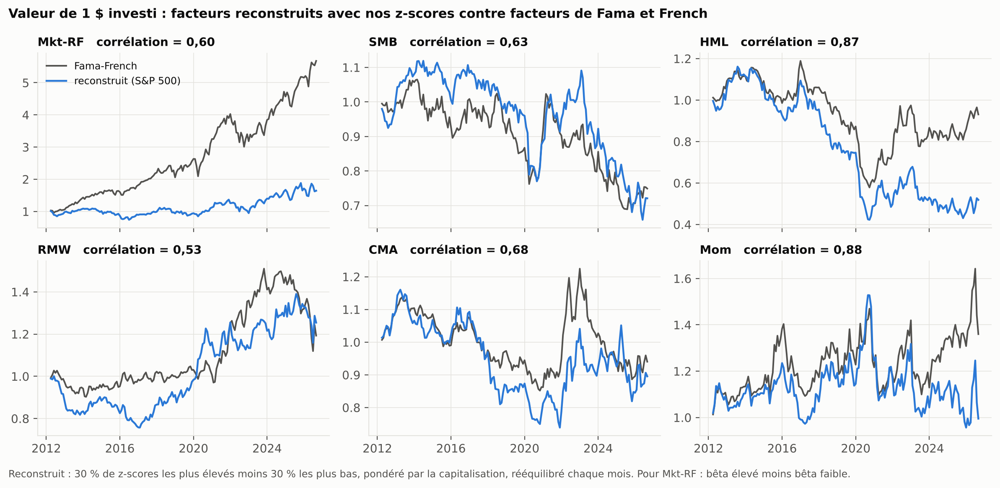

### 8.5 La base finale

Fichier : `data/processed/zscores_sp500_mensuels.csv.gz`.

- **Une ligne par (mois, action)** : 73 515 lignes, 598 entreprises, 175 mois de février 2012 à août 2026.
- **Colonnes** : mois, ticker, code SIC et grand secteur, les six caractéristiques brutes (capitalisation, fonds propres / capitalisation, rentabilité, croissance de l'actif, momentum, bêta), puis les six z-scores.
- **Taille** : 420 actions par mois en moyenne (337 au début, 500 à la fin). 85 % des lignes ont les six z-scores ; 359 actions par mois en moyenne.
- **Début en 2012** : premier mois où au moins la moitié des membres ont leurs six z-scores. Les comptes XBRL n'existent que depuis 2009-2011 selon la taille de l'entreprise : avant, presque aucun z-score comptable n'est disponible.
- **Moyenne 0, écart-type proche de 1** chaque mois, par construction. Moins de 2,5 % des valeurs touchent le plafond de ±3. `z_rmw` et `z_cma` sont plus asymétriques (écart-type 0,7 à 0,8 après plafond) : quelques entreprises ont des fonds propres minuscules après de gros rachats d'actions, ou une croissance d'actif énorme l'année d'une fusion.

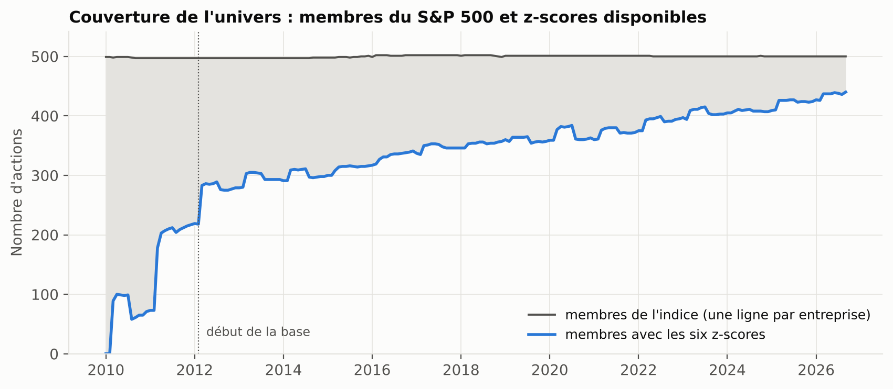

**Les z-scores se ressemblent peu.** Corrélation moyenne en coupe, mois par mois :

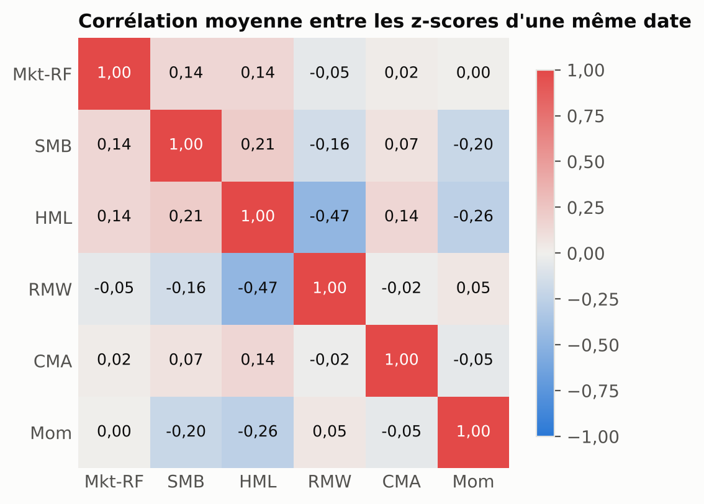

- La plus forte est value / rentabilité (−0,47) : les entreprises peu chères en bourse sont souvent les moins rentables.
- Les autres restent sous 0,3 en valeur absolue : chaque z-score apporte une information différente.

**Persistance.** Corrélation de rang entre le z-score d'une action au mois $t$ et au mois $t+h$ :

| | 1 mois | 3 mois | 12 mois |
|---|---:|---:|---:|
| `z_mkt` | 0,99 | 0,98 | 0,92 |
| `z_smb` | 1,00 | 0,99 | 0,96 |
| `z_hml` | 0,99 | 0,98 | 0,93 |
| `z_rmw` | 0,99 | 0,96 | 0,82 |
| `z_cma` | 0,94 | 0,82 | 0,26 |
| `z_mom` | 0,90 | 0,70 | −0,02 |

- Taille, value, bêta et rentabilité changent lentement : un rééquilibrage annuel suffit pour ces facteurs.
- Le momentum se renouvelle complètement en un an, l'investissement presque : ce sont les facteurs les plus coûteux en rotation (étape 7.3).

**Exemple : Apple.** Plus grosse capitalisation de l'indice, donc `z_smb` au plafond de −3. Action « chère » (`z_hml` négatif) mais très rentable : `z_rmw` monte jusqu'au plafond de +3 à partir de 2022, ses fonds propres ayant fondu sous l'effet des rachats d'actions. Cela confirme la lecture de l'étape 6.

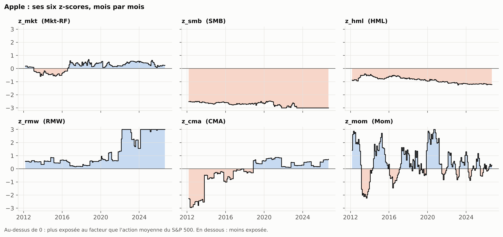

### 8.6 Les limites

- **Biais du survivant, la principale.** 206 des 847 entreprises passées dans l'indice n'ont plus de cours sur Yahoo Finance (rachetées, fusionnées ou faillies : Aetna, Celgene, Time Warner, Xilinx...). Elles manquent à la base, ce qui explique l'essentiel de l'écart entre les membres et les actions couvertes sur le graphique de couverture. Ce sont surtout des entreprises sorties de l'indice tôt, d'où une couverture plus faible au début (57 % en 2012 contre 88 % en 2026). Une base professionnelle (CRSP, Compustat) corrigerait ce point.
- **Historique court.** XBRL n'existe que depuis 2009, contre 1963 pour les facteurs de French. Avec 14 ans de z-scores, l'étage 1 maison ne pourra pas être testé sur plusieurs cycles.
- **Fonds propres simplifiés.** Fama et French ajoutent les impôts différés, rarement publiés à part dans XBRL : ils ne sont pas réintégrés.
- **Rentabilité approchée.** Résultat d'exploitation au lieu du détail chiffre d'affaires − coûts ; résultat avant impôts pour les banques et assurances.
- **Secteur actuel seulement.** Le code SIC est celui d'aujourd'hui, pas celui de chaque date.
- **Capitalisation mensuelle.** Fama et French mesurent la taille une fois par an, en juin ; ici elle est mise à jour chaque mois.
- **Plusieurs catégories d'actions.** Une seule ligne est gardée par entreprise. Le nombre d'actions publié peut ne couvrir qu'une des catégories : Berkshire Hathaway, dont les deux actions ont des prix très différents, n'a pas de capitalisation fiable et sort des z-scores de taille et de value.
- **Ajustements de Yahoo.** Yahoo traite certaines scissions d'entreprise comme des divisions d'actions (Agilent en 2014). L'effet est neutre sur la capitalisation, puisque cours et nombre d'actions sont ajustés du même ratio, mais il reste une source d'erreur possible.

### 8.7 À retenir de l'étape 8

- **L'étage 1 est construit sur données réelles** : six z-scores par action et par mois, pour les membres du S&P 500 de 2012 à 2026, en n'utilisant à chaque date que des comptes déjà publiés.
- **Les calculs sont validés** : les facteurs reconstruits suivent ceux de Fama et French (corrélation de 0,87 à 0,88 pour la value et le momentum, de 0,53 à 0,68 pour les autres), avec des écarts qui s'expliquent par un univers limité aux grandes capitalisations.
- **La donnée est la vraie difficulté** : tickers réattribués, holdings sans historique, erreurs d'unité dans les comptes, entreprises disparues. La limite qui reste, le biais du survivant, est connue et mesurée.

## Étape 9 : étage 2, l'allocation par facteurs bat-elle le S&P 500 ?

On passe des z-scores de l'étape 8 à un vrai portefeuille, puis on le backteste avec des frais. Code et résultats : [`notebooks/etape9_allocation_backtest.ipynb`](notebooks/etape9_allocation_backtest.ipynb).

### 9.1 Les choix de départ

- **Long-only.** L'univers est le S&P 500, choisi pour être investissable, et le long-only est la version des fonds multi-facteurs (étape 7.3). Pas de vente à découvert, donc pas de coût d'emprunt de titres. Le portefeuille reste exposé au marché : les facteurs servent à **choisir et pondérer** les actions.
- **Cinq facteurs dans le score : SMB, HML, RMW, CMA, Mom.** Le bêta (`z_mkt`) n'y entre pas. Le portefeuille est déjà exposé au marché, et favoriser les actions à bêta élevé n'a pas été rémunéré (Frazzini et Pedersen, 2014).
- **Période** : mars 2012 à août 2026, 174 mois.

### 9.2 Le score final de chaque action

$$S_{i,t} = \sum_k w_{k,t}\, z_{i,k,t}, \qquad \sum_k w_{k,t} = 1$$

puis $S$ est re-standardisé chaque mois (moyenne 0, écart-type 1).

- **Équipondéré** : chaque facteur pèse 20 %.
- **ERC** : chaque facteur apporte la même part du risque. Le calcul se fait sur la volatilité et les corrélations des facteurs de Fama et French des 60 mois précédents. En moyenne : RMW 30 %, SMB 23 %, CMA 18 %, Mom 17 %, HML 13 %. RMW, le facteur le plus calme, pèse le plus.
- Une action doit avoir au moins 3 z-scores sur 5 ; un z-score manquant compte pour 0.
- Les deux scores se ressemblent beaucoup : corrélation de 0,92.

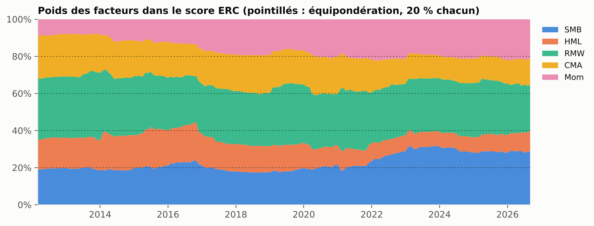

### 9.3 Du score au portefeuille

Chaque fin de mois :
1. **Sélection** : les 30 % d'actions au meilleur score.
2. **Zone tampon** : une action déjà détenue n'est vendue que si elle sort des 40 % meilleurs. Sans cela, une action qui oscille autour du seuil serait achetée et vendue sans arrêt.
3. **Pondération** : $w_i \propto \text{capitalisation}_i \times (1 + S_i)$. On part du poids de l'action dans l'indice et on l'augmente selon son score.
4. **Plafond de 10 % par action**, comme la règle de diversification des fonds européens (OPCVM). Sans lui, Apple, très grosse et bien notée en 2020, aurait pesé jusqu'à 37 % du portefeuille.
5. **Frais** : 0,10 % de chaque dollar acheté ou vendu, retiré du rendement. C'est un ordre de grandeur réaliste pour des grandes capitalisations américaines.

Résultat : environ 140 actions en portefeuille (de 97 à 172 selon les mois).

Les poids dérivent avec les cours pendant le mois. La rotation compte tout ce qu'il faut acheter et vendre pour revenir aux poids cibles.

### 9.4 Les benchmarks

- **Univers pondéré par la capitalisation** (benchmark principal) : toutes les actions de la base, au poids de l'indice. Mêmes actions et mêmes données que les stratégies, donc seul l'effet des facteurs les sépare.
- **SPY** : acheter le S&P 500 et le garder, ce qu'un investisseur aurait vraiment obtenu.
- **RSP** : le S&P 500 équipondéré.

### 9.5 Résultats

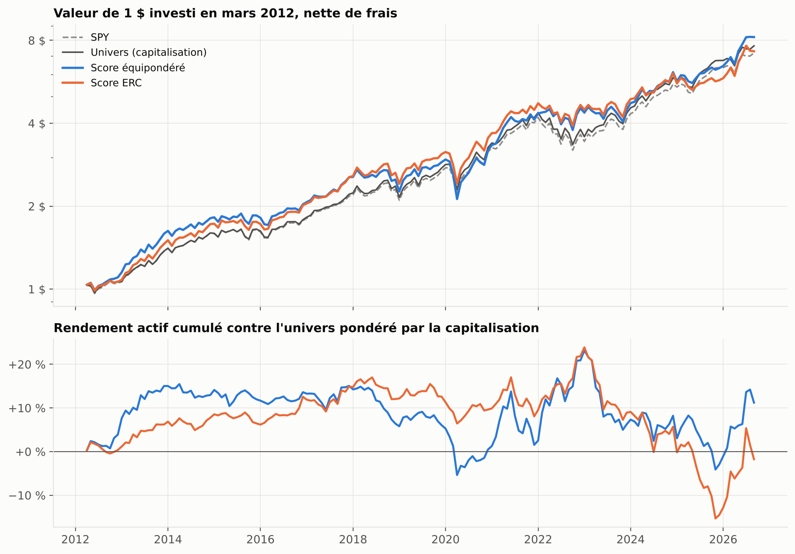

Nets de frais, mars 2012 à août 2026 :

| | Rendement annuel | Volatilité | Sharpe | Perte maximale | Rotation annuelle |
|---|---:|---:|---:|---:|---:|
| Score équipondéré | 15,6 % | 15,8 % | 0,90 | −28,2 % | 315 % |
| Score ERC | 14,7 % | 15,4 % | 0,87 | −23,2 % | 278 % |
| Univers (capitalisation) | 15,1 % | 14,0 % | 0,96 | −23,6 % | 11 % |
| SPY | 14,6 % | 14,0 % | 0,93 | −23,9 % | |
| RSP | 12,5 % | 15,1 % | 0,75 | −26,7 % | |

- **Le score équipondéré fait +0,8 % par an de plus que l'univers, le score ERC −0,1 %.**
- **Aucune des deux ne fait mieux en Sharpe** : leur volatilité est plus forte que celle de l'indice (15,4 à 15,8 % contre 14,0 %).
- **Rotation élevée** : environ 300 % par an, achats et ventes compris, soit 1,5 fois le portefeuille remplacé chaque année. Cela coûte 0,3 % par an en frais. C'est surtout le momentum qui tourne : son z-score se renouvelle complètement en un an (étape 8.5).

### 9.6 Ces écarts sont-ils significatifs ?

Tests sur le rendement actif mensuel (stratégie − benchmark) :
- **$t$ de Newey-West** : robuste à l'autocorrélation des rendements.
- **Bootstrap par blocs de mois** (5 000 tirages) : intervalle de confiance à 95 %.

| Stratégie | Benchmark | Rendement actif | Écart de suivi | IR | $t$ | Intervalle à 95 % |
|---|---|---:|---:|---:|---:|---|
| Score équipondéré | Univers | +0,8 % | 7,2 % | 0,11 | 0,38 | −2,9 % à +4,5 % |
| Score ERC | Univers | −0,1 % | 6,4 % | −0,02 | −0,07 | −3,5 % à +3,0 % |
| Score équipondéré | Score ERC | +0,9 % | 3,8 % | 0,23 | 0,81 | −1,2 % à +3,1 % |
| Univers | SPY | +0,4 % | 0,8 % | 0,55 | 2,64 | +0,1 % à +0,7 % |

- **Rien n'est significatif pour les stratégies.** Les intervalles contiennent largement zéro. L'écart entre équipondéré et ERC ne l'est pas non plus.
- **Le backtest est trop court pour trancher.** Avec 14,5 ans, il faudrait un ratio d'information d'au moins 0,53 pour obtenir $t = 2$. Les fonds factoriels visent plutôt 0,3 à 0,5.
- **30 variantes testées** (pondérations, seuils, zones tampons). La meilleure, celle retenue ci-dessus, a un IR de 0,11. Corrigé du nombre d'essais (ratio de Sharpe dégonflé), la probabilité que son vrai IR soit positif n'est que de 38 %.
- **Le biais du survivant se voit** : l'univers bat SPY de 0,4 % par an, de façon significative ($t = 2{,}6$). Les entreprises disparues manquent à la base (étape 8.6). C'est pourquoi le benchmark principal est l'univers, qui a le même biais que les stratégies.

### 9.7 Pourquoi ça ne paie pas : les facteurs n'ont presque rien rapporté depuis 2012

**La méthode fonctionne : les stratégies portent bien les facteurs voulus.** Régression sur les six facteurs de Fama et French (étape 4) :

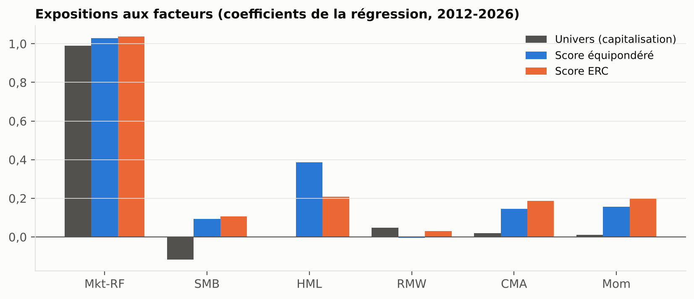

- Expositions positives à la value (HML), à l'investissement (CMA), au momentum et à la taille. L'univers, lui, est neutre ou exposé à l'envers (SMB −0,12).
- **Alpha nul** ($t$ de 0,35 et −0,53) : toute la performance s'explique par ces expositions.
- **RMW reste presque à zéro**, même dans le score ERC où il pèse 30 %. Les z-scores de rentabilité et de value sont opposés (corrélation −0,47, étape 8.5). Dans le score, ils s'annulent en partie : les actions les plus rentables sont souvent chères, donc pénalisées par HML.

**Mais les facteurs n'ont pas été rémunérés pendant le backtest** (rendement annuel moyen des facteurs de Fama et French) :

| | Mkt-RF | SMB | HML | RMW | CMA | Mom |
|---|---:|---:|---:|---:|---:|---:|
| 1963-2011 | 5,3 % | 3,4 % | 4,5 % | 3,5 % | 3,9 % | 8,6 % |
| 2012-2026 | 13,1 % | −1,5 % | 0,2 % | 1,5 % | −0,1 % | 3,0 % |

- **Sur 2012-2026, aucune prime de style n'est significative**, alors qu'elles l'étaient toutes avant 2012. Le marché, lui, a rapporté 13 % par an.
- Une stratégie qui s'éloigne de l'indice pour porter ces facteurs ne pouvait donc pas gagner grand-chose : elle a pris du risque en plus (écart de suivi de 7 %) pour une prime presque nulle.

### 9.8 Robustesse

- **Sous-périodes** : l'ERC fait +1,4 % par an contre l'univers en 2012-2019, puis −2,0 % en 2020-2026. L'équipondéré fait +0,7 % puis +0,9 %. Aucun écart n'est significatif.
- **Pondération** : avec des poids égaux entre actions, les deux scores perdent face à l'univers (−0,2 % et −0,5 % par an). La pondération par capitalisation × (1 + score) fait mieux, parce qu'elle reste plus proche de l'indice.
- **Seuil et zone tampon** : de 20 % à 50 % d'actions retenues, le rendement actif reste entre −1,6 % et +0,8 % par an, jamais significatif. La zone tampon réduit la rotation d'environ 30 % (de 450 % à 315 % par an pour le score équipondéré).
- **Frais** : l'avance du score équipondéré disparaît vers 0,35 % de frais par dollar échangé, celle du score ERC dès 0,05 %.

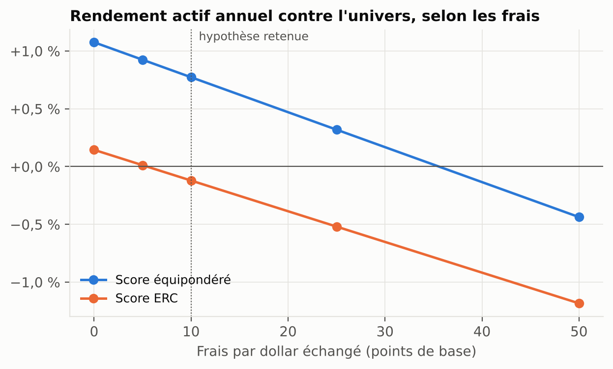

### 9.9 À retenir de l'étape 9

- **La chaîne complète fonctionne** : des comptes et des cours jusqu'à un portefeuille investissable, avec frais, zone tampon et des expositions conformes à ce qu'on vise.
- **Sur 2012-2026, l'allocation par facteurs ne bat pas le S&P 500 de façon significative.** Score équipondéré : +0,8 % par an contre l'univers ($t = 0{,}4$). Score ERC : −0,1 %.
- **La raison n'est pas la méthode mais la période** : les primes de style n'ont presque rien rapporté depuis 2012, alors que le marché a fortement monté.
- **L'ERC ne fait pas mieux que l'équipondération ici.** Répartir le risque entre facteurs n'aide pas quand aucun facteur ne rapporte, et les deux scores sont trop proches (corrélation 0,92) pour se départager en 14 ans.
- **Limites** : un backtest court (14,5 ans, il faudrait un IR de 0,53 pour conclure), le biais du survivant, des frais simplifiés (taux fixe, sans impact de marché selon la taille de l'ordre).

## Étape 10 : améliorer la méthode d'allocation

### 10.1 L'ERC calculé sur nos propres facteurs

À l'étape 9, les poids ERC viennent des volatilités et corrélations des facteurs de Fama et French. Ici, on les calcule sur les **facteurs reconstruits sur le S&P 500** (étape 8.4). Tout le reste est inchangé. Code : [`notebooks/etape10_erc_facteurs_reconstruits.ipynb`](notebooks/etape10_erc_facteurs_reconstruits.ipynb).

**Pourquoi c'est intéressant :**
- Le risque qui compte est celui des facteurs **tels qu'on les investit**. Or nos facteurs ne sont qu'en partie ceux de French : corrélation de 0,53 (RMW) à 0,88 (Mom).
- Ils sont plus volatils (HML 15 % contre 12 %, CMA 10 % contre 8 %) et beaucoup plus liés entre eux. Dans le S&P 500, petites et « value » vont souvent ensemble : SMB et HML sont corrélés à 0,78, contre 0,33 chez French.
- Si l'ERC est sensible à ces différences, les poids changent, et le portefeuille aussi.

**Contrainte** : nos facteurs démarrent en mars 2012. Avec 60 mois d'historique, les premiers poids sont disponibles en février 2017, d'où une comparaison sur **mars 2017 à août 2026** (114 mois).

**Les poids bougent peu**, et les scores restent presque identiques (corrélation de 0,96) :

| | SMB | HML | RMW | CMA | Mom |
|---|---:|---:|---:|---:|---:|
| ERC French | 24 % | 11 % | 29 % | 16 % | 20 % |
| ERC reconstruit | 19 % | 15 % | 32 % | 13 % | 21 % |

**Backtest** (mêmes règles qu'à l'étape 9, nets de 0,10 % de frais par dollar échangé, mars 2017 à août 2026) :

| | Rendement annuel | Volatilité | Sharpe | Perte maximale | Rotation annuelle |
|---|---:|---:|---:|---:|---:|
| ERC French (étape 9) | 13,7 % | 17,4 % | 0,69 | −23,2 % | 312 % |
| ERC reconstruit | 14,0 % | 17,0 % | 0,72 | −24,9 % | 308 % |
| Univers (capitalisation) | 15,6 % | 15,7 % | 0,85 | −23,6 % | |
| SPY | 15,0 % | 15,6 % | 0,82 | −23,9 % | |

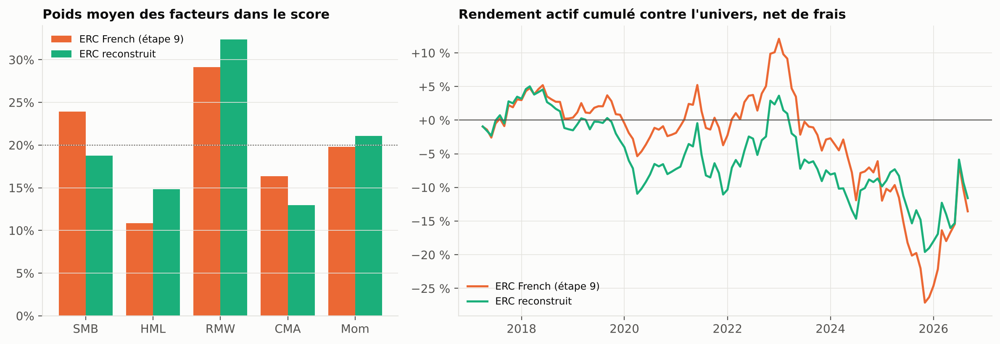

- **ERC reconstruit contre ERC French : +0,2 % par an**, avec $t = 0{,}19$. L'intervalle à 95 % va de −1,8 % à +2,5 %. Les deux versions sont statistiquement indiscernables.
- **Contre l'univers, les deux restent derrière** : −1,2 % et −1,4 % par an, non significatif. La période 2017-2026 est la plus défavorable aux facteurs de style.
- **Conclusion** : le résultat de l'étape 9 ne dépend pas de la source des volatilités et corrélations. Changer les poids entre facteurs ne suffit pas quand les facteurs eux-mêmes ne sont pas rémunérés.

### 10.2 Long-short sur les facteurs de Fama et French

**Pourquoi tester ça :**
- En long-only (étape 9), la volatilité du portefeuille vient surtout du marché (bêta de 1,04). Les facteurs ne font qu'**incliner** le choix des actions, et l'ERC ne pilote qu'un score.
- En long-short, le portefeuille **est** un panier de facteurs. L'ERC agit alors directement sur son risque : c'est le cadre où la méthode a été pensée (étape 7).
- Les facteurs de French existent depuis 1963 : on peut tester sur 58 ans au lieu de 14.

**Ce qui change dans la méthode d'allocation :**

| | Long-only (étape 9) | Long-short (10.2) |
|---|---|---|
| Ce qu'on achète | les 30 % d'actions au meilleur score | chaque facteur : 30 % meilleures actions achetées, 30 % moins bonnes vendues à découvert |
| Rôle des poids ERC | pondérer les z-scores dans un score unique | répartir le portefeuille entre les 5 facteurs |
| Exposition au marché | bêta ≈ 1 | proche de 0 |
| Exposition aux facteurs | diluée (HML 0,39, RMW ≈ 0) | complète : chaque facteur reçoit son poids |
| Rendement obtenu | marché + petit écart | primes des facteurs seules |
| Contraintes | aucune | vente à découvert, coût d'emprunt des titres, rotation plus forte |

C'est la voie « mix » de l'étape 7.3 : un portefeuille par facteur, puis une allocation entre eux. Le long-only de l'étape 9 suivait la voie « intégrée ».

**Méthode** (code : [`notebooks/etape10_2_long_short.ipynb`](notebooks/etape10_2_long_short.ipynb)) :
- Chaque mois, poids des 5 facteurs : 20 % chacun, ou ERC sur la covariance des 60 mois précédents.
- **Frais** : les facteurs de French sont calculés sans frais. On mesure la rotation de chaque facteur sur nos facteurs reconstruits (étape 8.4) et on applique 0,10 % par dollar échangé, comme à l'étape 9. Le momentum coûte le plus (1,2 % par an), les autres de 0,2 à 0,3 %. C'est une estimation basse : le coût d'emprunt des titres vendus et les petites capitalisations, plus chères à échanger, ne sont pas comptés.
- Un portefeuille long-short n'immobilise pas de capital : son rendement se compare au **rendement actif** du long-only (stratégie − univers), qui est aussi un pari pur sur les facteurs.

**Résultats sur la période de l'étape 9** (mars 2012 à août 2026, nets de frais) :

| | Rendement annuel | Volatilité | Sharpe | $t$ | Perte maximale |
|---|---:|---:|---:|---:|---:|
| Long-short équipondéré | +0,1 % | 4,6 % | 0,03 | 0,11 | −16,5 % |
| Long-short ERC | +0,2 % | 4,0 % | 0,04 | 0,13 | −14,3 % |
| Long-only score équipondéré (actif) | +0,8 % | 7,2 % | 0,11 | 0,38 | −24,7 % |
| Long-only score ERC (actif) | −0,1 % | 6,4 % | −0,02 | −0,07 | −33,2 % |

**Sur tout l'historique** (juillet 1968 à août 2026, nets de frais) :

| | Période | Rendement annuel | Volatilité | Sharpe | $t$ | Perte maximale |
|---|---|---:|---:|---:|---:|---:|
| Long-short équipondéré | 1968-2011 | +4,2 % | 4,7 % | 0,90 | 5,19 | −13,9 % |
| | 2012-2026 | +0,1 % | 4,6 % | 0,03 | 0,11 | −16,5 % |
| Long-short ERC | 1968-2011 | +3,8 % | 4,1 % | 0,93 | 5,33 | −10,8 % |
| | 2012-2026 | +0,2 % | 4,0 % | 0,04 | 0,13 | −14,3 % |

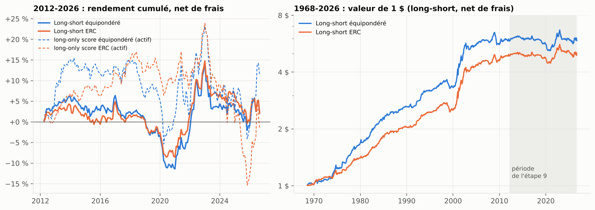

- **Sur 2012-2026, le long-short ne fait pas mieux que le long-only** : rendement quasi nul, car les primes elles-mêmes sont quasi nulles (étape 9.7). Le long-short a un risque plus faible (volatilité de 4 à 5 % contre 6 à 7 %), mais rien à rémunérer.
- **Avant 2012, la même méthode marchait très bien** : Sharpe de 0,9 net de frais, $t$ supérieur à 5. Le résultat de l'étape 9 tient à la période, pas à la façon de construire le portefeuille.
- **L'ERC fait ce qu'on attend de lui en long-short** : sur 1968-2026, même Sharpe que l'équipondération (0,69 contre 0,67), mais volatilité plus faible (4,1 % contre 4,7 %) et perte maximale réduite (−14 % contre −20 %). Il ne crée pas de rendement, il **réduit le risque** pour le même rendement par unité de risque.
- **Limites** : coût d'emprunt des titres non compté, frais estimés sur le S&P 500 alors que French inclut des petites capitalisations. Les résultats nets sont donc plutôt optimistes.

## Références

- Bailey D., López de Prado M. (2014), The Deflated Sharpe Ratio: Correcting for Selection Bias, Backtest Overfitting and Non-Normality, *Journal of Portfolio Management*.
- Banz R. (1981), The Relationship Between Return and Market Value of Common Stocks, *Journal of Financial Economics*.
- Basu S. (1977), Investment Performance of Common Stocks in Relation to Their Price-Earnings Ratios, *Journal of Finance*.
- Carhart M. (1997), On Persistence in Mutual Fund Performance, *Journal of Finance*.
- Chow G. (1960), Tests of Equality Between Sets of Coefficients in Two Linear Regressions, *Econometrica*.
- Daniel K., Moskowitz T. (2016), Momentum Crashes, *Journal of Financial Economics*.
- Fama E., French K. (1993), Common Risk Factors in the Returns on Stocks and Bonds, *Journal of Financial Economics*.
- Fama E., French K. (2015), A Five-Factor Asset Pricing Model, *Journal of Financial Economics*.
- Frazzini A., Pedersen L. (2014), Betting Against Beta, *Journal of Financial Economics*.
- Jegadeesh N., Titman S. (1993), Returns to Buying Winners and Selling Losers, *Journal of Finance*.
- Kraskov A., Stögbauer H., Grassberger P. (2004), Estimating Mutual Information, *Physical Review E*.
- Linfoot E. (1957), An Informational Measure of Correlation, *Information and Control*.
- Maillard S., Roncalli T., Teïletche J. (2010), The Properties of Equally Weighted Risk Contribution Portfolios, *Journal of Portfolio Management*.
- Politis D., Romano J. (1994), The Stationary Bootstrap, *Journal of the American Statistical Association*.
- Roncalli T. (2017), *Alternative Risk Premia: What Do We Know?*, Amundi Working Paper WP-061-2017. [Lien](https://research-center.amundi.com/files/nuxeo/dl/e8c7f3a3-511c-4b68-a2fa-34d168f6a03d)
- Rosenberg B., Reid K., Lanstein R. (1985), Persuasive Evidence of Market Inefficiency, *Journal of Portfolio Management*.
- Sharpe W. (1964), Capital Asset Prices: A Theory of Market Equilibrium under Conditions of Risk, *Journal of Finance*.
- Kenneth French, *Data Library* : https://mba.tuck.dartmouth.edu/pages/faculty/ken.french/data_library.html
