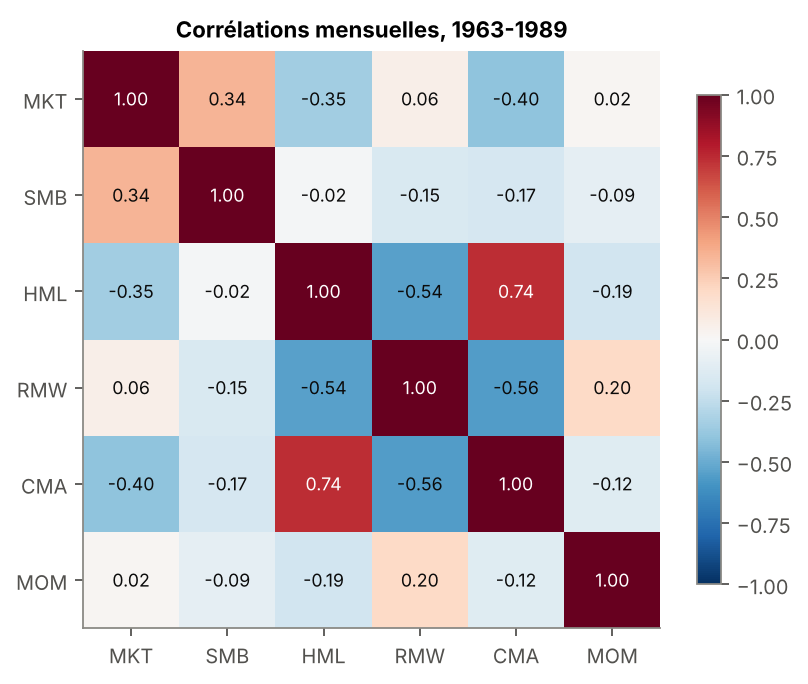
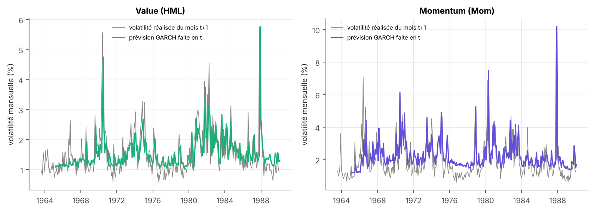
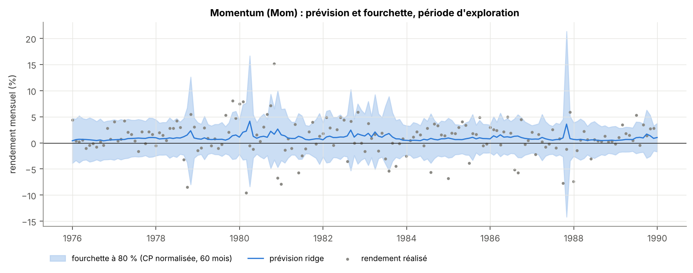
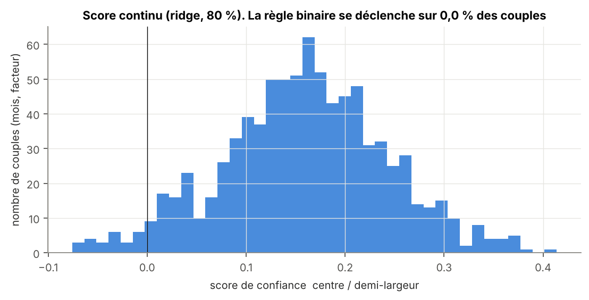
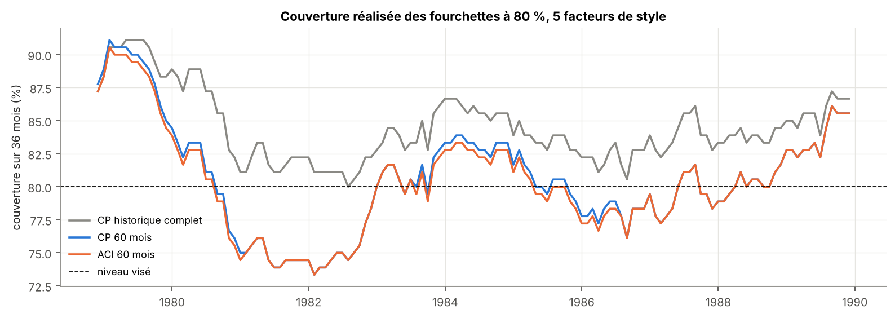

# Allocation dynamique entre facteurs : quand s'écarter de la parité de risque ?

**Question.** Je sais prévoir le risque des facteurs actions, beaucoup moins leur
rendement. Peut-on partir d'une allocation en parité de risque entre facteurs
et ne s'en écarter que dans la mesure où la prévision de rendement est
*mesurablement fiable*, en utilisant la Conformal Prediction comme jauge de
confiance ?

Projet de recherche personnel sur six semaines, avec un protocole écrit et
figé **avant** le premier backtest. Données publiques uniquement (Kenneth
French Data Library).

> **Où en est le projet.** Semaine 1 terminée : données figées et testées,
> variables construites sans fuite, test go/no-go fait sur 1963-1989, protocole
> signé (tag [`protocole-v1`](docs/protocole.md)). Aucune performance de
> stratégie n'a encore été calculée sur la période de test.

**Ce que la semaine 1 a déjà appris :**

1. Sur les facteurs aussi, **le risque se prévoit, le rendement très peu** : la
   volatilité GARCH du mois suivant est corrélée à 0,49-0,65 avec la volatilité
   réalisée, alors que la meilleure prévision de rendement n'explique que 0,9 %
   de la variance de plus que la moyenne historique.
2. La règle « ne s'écarter que si la fourchette exclut zéro » **ne se
   déclenche jamais** (0 cas sur 840). Le protocole la remplace par un score
   de confiance continu, avant tout test.
3. Les fourchettes conformes sont bien calibrées (82 % pour 80 % visé), à
   condition de les recalibrer sur une fenêtre glissante : la relation entre
   volatilité quotidienne et mensuelle a changé entre 1965 et 1990.

---

## Sommaire

1. [D'où vient ce projet](#1-doù-vient-ce-projet)
2. [Le lien avec la gestion multi-facteurs d'Amundi](#2-le-lien-avec-la-gestion-multi-facteurs-damundi)
3. [L'idée en une image](#3-lidée-en-une-image)
4. [Le cadre mathématique](#4-le-cadre-mathématique)
5. [Le protocole](#5-le-protocole)
6. [Semaine 1, étape par étape](#6-semaine-1-étape-par-étape)
7. [Planning et suite](#7-planning-et-suite)
8. [Reproduire](#8-reproduire)
9. [Références](#9-références)

---

## 1. D'où vient ce projet

Mon projet précédent, [strat-invest-direct](https://github.com/Anto279/strat-invest-direct),
construisait une allocation hebdomadaire sur 8 ETF multi-actifs (actions,
obligations, or, matières premières, immobilier) à partir de prévisions
ARIMA + XGBoost, de volatilités GARCH et d'une optimisation moyenne-variance,
testée en walk-forward de 2011 à 2026 avec exécution le jour suivant et frais.

Il a conduit à deux conclusions nettes :

| Ce qui ne marchait pas | Ce qui marchait |
|---|---|
| **Prévoir le rendement.** R² hors échantillon proche de zéro ou négatif sur les 8 actifs ; la validation croisée purgée a appris d'elle-même à donner un **poids nul** aux prévisions. | **Prévoir le risque.** Le GARCH bat une moyenne exponentielle (Diebold-Mariano, p = 0,015) et le pilotage par budget de volatilité réduit nettement les pertes : perte maximale de −12 % contre −21 % pour un 60/40. |

Le portefeuille final (Sharpe 0,66 contre 0,83 pour le 60/40) protégeait mieux
mais ne rapportait pas plus. La leçon : **sans prévision de rendement fiable,
la valeur vient de la gestion du risque.** J'en tire trois conséquences :

1. **Changer d'univers.** Au lieu d'actifs dont l'espérance de gain dépend
   entièrement de la prévision, j'alloue entre **primes factorielles** (taille,
   value, rentabilité, investissement, momentum), documentées depuis des
   décennies et rémunérées en moyenne sans rien prévoir.
2. **Bâtir sur ce qui marche.** Le socle est la **parité de risque** entre
   facteurs, qui n'utilise que les volatilités prévues par GARCH.
3. **Ne s'écarter du socle que quand c'est justifié.** Plutôt que de suivre une
   prévision à la lettre, je mesure sa fiabilité date par date avec la
   **Conformal Prediction** et je dévie en proportion.

Le projet reprend aussi les garde-fous que l'exercice précédent m'a appris :
protocole figé avant le premier test, exécution décalée d'une période, Deflated
Sharpe Ratio sur le nombre total d'essais (j'avais testé plus de 1 000
configurations sans correction), bootstrap par blocs, et un échantillon qui
couvre plusieurs crises (1973-74, 1987, 2000-02, 2008-09, 2020).

## 2. Le lien avec la gestion multi-facteurs d'Amundi

En 2024, Amundi a reçu le prix *Equity Multi-Factor Solution Provider of the
Year* (Professional Pensions Investment Awards) pour sa stratégie **Global
Dynamic Multi-Factor Equity**. D'après les documents publics de l'équipe
(Amundi Viewpoint *Factor investing*, 2017 ; communiqué de lancement, 2018),
le processus repose sur trois étages :

```
  1. Allocation stratégique        2. Ajustements dynamiques        3. Construction
  ERC entre facteurs        ──▶    selon le régime de marché  ──▶   du portefeuille
  (value, momentum, qualité,       et la valorisation               sous contraintes
   faible vol., taille)                                              (secteurs, pays, coûts)
                                   ▲
                                   └── ce projet
```

Mon projet se place à l'étage 2. Il ne reproduit pas le modèle d'Amundi, qui
n'est pas public : il part du **même socle public**, la parité de risque entre
facteurs, et pose la question que tout ajustement dynamique doit résoudre :

> *À quel moment un signal est-il assez fiable pour justifier de s'écarter de
> l'allocation de référence, compte tenu des frais et d'un budget de risque
> limité ?*

La méthode est générique : elle porte sur l'usage de l'incertitude d'une
prévision, pas sur la prévision elle-même. Elle s'applique donc à n'importe
quel signal (régime, valorisation, momentum de facteurs, apprentissage
automatique).

Deux différences avec un fonds réel, assumées dès le départ : les facteurs
French sont des portefeuilles **long-short** théoriques alors qu'un fonds
multi-facteurs est long-only face au MSCI World (une version « jambe longue »
est prévue en robustesse), et les coûts internes aux facteurs ne sont pas
modélisés.

## 3. L'idée en une image

Pour le mois prochain, le modèle prévoit +0,8 % pour le facteur momentum.

| | Fourchette à 80 % | Ce qu'elle dit | Décision |
|---|---|---|---|
| Cas A | [−2,5 % ; +4,1 %] | contient zéro : le modèle ne sait pas | rester près de la parité de risque |
| Cas B | [+0,3 % ; +1,6 %] | étroite et entièrement positive | surpondérer le momentum, dans un budget fixé |

Même prévision centrale, décisions opposées : c'est la valeur ajoutée de
l'incertitude. Le test central du projet compare donc **la même prévision
utilisée avec et sans fourchette**.

## 4. Le cadre mathématique

### 4.1 Les facteurs

Un facteur est le rendement d'un portefeuille long-short construit sur une
caractéristique des actions. Par exemple HML achète les actions à fort ratio
valeur comptable / capitalisation et vend celles à faible ratio. Le modèle de
Fama et French (2015) augmenté du momentum (Carhart, 1997) explique le
rendement excédentaire d'un titre $i$ par :

$$r_{i,t} - r_{f,t} = \alpha_i + \beta_i\,MKT_t + s_i\,SMB_t + h_i\,HML_t + r_i\,RMW_t + c_i\,CMA_t + m_i\,MOM_t + \varepsilon_{i,t}$$

Cette équation relie des grandeurs **du même mois** : elle explique, elle ne
prévoit pas. Toute la dynamique du projet vient de modèles qui utilisent
l'information de la fin du mois $t$ pour décider des poids du mois $t+1$.

### 4.2 Le socle : parité de risque (ERC)

Pour des poids $w$ et une covariance prévue $\Sigma$, la contribution du
facteur $f$ au risque du portefeuille est
$RC_f = w_f\,(\Sigma w)_f / \sqrt{w^\top \Sigma w}$. Le portefeuille ERC
(Maillard, Roncalli et Teiletche, 2010) impose $RC_f = RC_g$ pour tous les
facteurs, avec $w_f \ge 0$ et $\sum_f w_f = 1$. Il n'utilise **aucune
prévision de rendement**.

### 4.3 Le risque : GARCH(1,1)

Sur les rendements quotidiens de chaque facteur :

$$\sigma^2_{d+1} = \omega + \alpha\,\varepsilon_d^2 + \beta\,\sigma_d^2, \qquad
\mathbb{E}_d[\sigma^2_{d+h}] = V + (\alpha+\beta)^{h-1}\,(\sigma^2_{d+1} - V), \quad V = \frac{\omega}{1-\alpha-\beta}$$

La variance prévue du mois suivant est la somme des 21 prévisions
quotidiennes : $\hat\sigma^2_{f,t} = \sum_{h=1}^{21}\mathbb{E}_t[\sigma^2_{f,t+h}]$.
Les paramètres sont réestimés chaque fin d'année sur les seules données
disponibles.

### 4.4 Le rendement : ridge en panel

Plutôt que de chercher des variables propres à chaque facteur (beaucoup de
réglages, donc de surajustement), un seul modèle est estimé sur les 5
facteurs empilés, avec deux signaux documentés dans la littérature :

$$z_{f,t} = \frac{r_{f,t+1}}{\hat\sigma_{f,t}} = a_f + b_1\,\text{mom}_{f,t} + b_2\,\text{vol}_{f,t} + \varepsilon_{f,t+1}$$

- $\text{mom}_{f,t}$ : rendement des 12 derniers mois rapporté à sa volatilité
  réalisée (momentum de facteurs, Ehsani et Linnainmaa, 2022) ;
- $\text{vol}_{f,t}$ : log de la volatilité réalisée du mois, moins sa moyenne
  sur les 60 mois précédents (gestion par la volatilité, Moreira et Muir, 2017) ;
- $a_f$ : prime moyenne propre à chaque facteur, non pénalisée.

Les coefficients $b$ sont estimés par ridge, $\min \sum (z - a_f - b^\top x)^2 + \lambda\,\|b\|^2$,
ce qui les rétrécit vers zéro : par défaut, le modèle doute du signal.

### 4.5 La jauge de confiance : Conformal Prediction normalisée

Score de non-conformité, connu une fois le rendement observé :
$S_{f,t} = |z_{f,t} - \hat z_{f,t}| = |r_{f,t+1} - \hat\mu_{f,t}| / \hat\sigma_{f,t}$.

Fourchette à 80 % ($\alpha = 0{,}2$) pour le mois suivant :

$$\left[\hat\mu_{f,t} - q_t\,\hat\sigma_{f,t}\;;\;\hat\mu_{f,t} + q_t\,\hat\sigma_{f,t}\right],
\qquad q_t = S_{(k)},\; k = \lceil (n+1)(1-\alpha) \rceil$$

où $S_{(k)}$ est le $k$-ième plus petit des $n$ scores déjà observés. Si les
scores sont échangeables, la couverture vaut au moins $1-\alpha$, **sans
hypothèse de loi normale**. Cette garantie porte sur la moyenne, pas sur
chaque mois. La fourchette s'élargit quand $\hat\sigma$ monte : l'adaptation
vient du GARCH, la calibration vient de la CP.

### 4.6 La règle de décision

$$s_{f,t} = \operatorname{clip}\!\left(\frac{\text{centre}}{\text{demi-largeur}},\,-1,\,1\right)
= \operatorname{clip}\!\left(\frac{\hat\mu_{f,t}}{q_t\,\hat\sigma_{f,t}},\,-1,\,1\right)
\qquad
w_{f,t} = \frac{w^{ERC}_{f,t}\,(1 + s_{f,t})}{\sum_g w^{ERC}_{g,t}\,(1 + s_{g,t})}$$

Une fourchette centrée sur zéro donne $s = 0$ : on reste sur l'ERC. Le poids
d'un facteur tombe à zéro quand la borne haute de sa fourchette touche zéro,
et double quand la borne basse touche zéro.

## 5. Le protocole

Le protocole complet est dans [docs/protocole.md](docs/protocole.md), figé par
le tag `protocole-v1`. Ses points clés :

| Période | Rôle | Ce qui est permis |
|---|---|---|
| 07/1963 - 12/1989 | exploration et calibration | tous les choix se font ici |
| 01/1990 - 08/2026 | test sous scellé | un seul passage, walk-forward |
| Developed, Europe, Japon | réplication | mêmes paramètres, aucun réglage |

| Hypothèse | Test | Seuil |
|---|---|---|
| H1. Les fourchettes sont calibrées | couverture réalisée, globale et par régime | ±3 points de 80 % |
| H2. La fourchette améliore l'usage de la prévision | « avec CP » moins « sans CP », apparié | t de Newey-West > 2 |
| H3. La méthode bat la parité de risque après frais | « avec CP » moins ERC, apparié | t > 2 et Deflated Sharpe > 0,95 |

Benchmarks : 1/N, ERC, ERC à volatilité ciblée, momentum de facteurs, même
prévision sans fourchette. Frais de 10 points de base par rotation, sensibilité
à 0, 25 et 50. Chaque essai sur la période de test est inscrit dans le
[journal des essais](docs/journal_des_essais.md).

## 6. Semaine 1, étape par étape

| # | Étape | Livrable | Statut |
|---|---|---|---|
| 1 | Question et brouillon du protocole | [docs/protocole.md](docs/protocole.md) | fait |
| 2 | Copie figée et datée des données brutes | `data/raw/2026-10-15/` + SHA-256 | fait |
| 3 | Construction de la base propre | `src/data/build_factors.py` | fait |
| 4 | Tests de cohérence | `tests/test_data.py` | fait, 20 tests passent |
| 5 | Variables décalées et test anti-fuite | `src/features.py`, `tests/test_features.py` | fait |
| 6 | Test go/no-go sur 1963-1989 | `scripts/go_no_go.py`, `results/` | fait : règle binaire rejetée |
| 7 | Protocole figé | tag `protocole-v1` | fait |

### Étape 2. Figer les données

French révise régulièrement ses séries (changement de base CRSP, révisions
des valeurs comptables). Les 11 fichiers ont été téléchargés le 15/10/2026
(base CRSP 202608 pour les États-Unis, Bloomberg 202608 pour les régions),
copiés tels quels dans `data/raw/2026-10-15/` avec leur empreinte SHA-256.
Un test vérifie à chaque exécution qu'aucun fichier n'a été modifié.

| Fichier | Contenu | Période | Usage |
|---|---|---|---|
| `F-F_Research_Data_5_Factors_2x3` | Mkt-RF, SMB, HML, RMW, CMA, RF | 07/1963 - 08/2026, mensuel et quotidien | cœur de la base |
| `F-F_Momentum_Factor` | MOM | 1926 - 08/2026, mensuel et quotidien | 6e facteur |
| `Developed`, `Europe`, `Japan` (5 facteurs + MOM) | mêmes facteurs par région | 11/1990 - 08/2026, mensuel | réplication |
| `6_Portfolios_2x3` | 6 portefeuilles taille × valorisation | 07/1926 - 08/2026 | version « jambe longue » |

### Étape 3. La base

`build_factors.py` lit directement les CSV dans les zips (en-têtes de texte,
tableau mensuel puis tableau annuel à couper, dates AAAAMM ou AAAAMMJJ),
fusionne les 5 facteurs et le momentum, convertit les pourcentages en
décimaux et produit :

| Table | Période | Lignes | Colonnes |
|---|---|---|---|
| `factors_monthly.parquet` | 07/1963 - 08/2026 | 758 | MKT, SMB, HML, RMW, CMA, MOM, RF |
| `factors_daily.parquet` | 01/07/1963 - 31/08/2026 | 15 897 | idem |
| `factors_{developed,europe,japan}_monthly.parquet` | 11/1990 - 08/2026 | 430 chacune | idem |


Statistiques sur les deux périodes du découpage (extrait de
[results/statistiques_descriptives.md](results/statistiques_descriptives.md)) :

| | Moyenne mensuelle 1963-1989 | t-stat | Moyenne mensuelle 1990-2026 | t-stat | Volatilité mensuelle (ensemble) |
|---|---|---|---|---|---|
| MKT | 0,40 % | 1,6 | 0,75 % | 3,6 | 4,5 % |
| SMB | 0,33 % | 2,0 | 0,08 % | 0,6 | 3,0 % |
| HML | 0,48 % | 3,3 | 0,16 % | 1,0 | 3,0 % |
| RMW | 0,16 % | 1,9 | 0,31 % | 2,5 | 2,3 % |
| CMA | 0,35 % | 3,3 | 0,17 % | 1,6 | 2,1 % |
| MOM | 0,81 % | 4,2 | 0,44 % | 2,0 | 4,2 % |

Ce tableau décrit des séries publiques et largement étudiées ; il n'évalue
aucune stratégie. Il rappelle deux faits connus qui comptent pour la suite :
les primes de taille et de value sont nettement plus faibles après leur
publication (McLean et Pontiff, 2016), et un rendement moyen d'environ 0,3 %
par mois pour une volatilité d'environ 3 % rend toute prévision mensuelle
extrêmement bruitée.



Les corrélations justifient la parité de risque : HML et CMA sont très liés
(0,74), RMW leur est opposé (−0,54), et le momentum est presque indépendant des
autres. Une allocation au poids égal surchargerait le risque value/investissement.

### Étape 4. Tests de cohérence

`pytest` exécute 20 tests. Ceux qui portent sur la base vérifient : aucune
valeur manquante ni code −99,99 ; un index mensuel continu de 07/1963 à
08/2026 sans doublon ; des rendements en décimaux ; des ordres de grandeur
connus (prime de marché de 0,4 à 0,8 % par mois, volatilité de HML de 2 à
3,5 %, krach d'octobre 1987, krach du momentum de 2009) ; et l'accord entre
séries quotidiennes et mensuelles.

Ce dernier test a révélé une particularité : pour les cinq facteurs
Fama-French, le cumul des rendements quotidiens retrouve le mensuel à plus de
0,99 de corrélation, mais seulement à 0,97 pour le momentum. La raison est
dans la documentation de French : le momentum quotidien reconstitue ses
portefeuilles **chaque jour**, le mensuel **chaque mois**. Ce ne sont pas
exactement les mêmes séries. Conséquence : la volatilité du momentum est
estimée sur une série voisine, ce qui reste acceptable pour un modèle de
risque mais doit être dit.

### Étape 5. Variables décalées et test anti-fuite

Chaque variable indexée par la fin du mois $t$ n'utilise que des données
datées au plus tard de $t$ ; seule la cible regarde $t+1$. Deux tests le
vérifient :

1. **Invariance à la troncature.** On recalcule toutes les variables (y
   compris le GARCH) sur des données coupées à une date $T$ : les valeurs
   jusqu'à $T$ doivent être identiques à celles calculées sur l'historique
   complet. Une seule variable qui regarde le futur ferait échouer le test.
2. **Détecteur de fuite.** Avec la vraie cible $r_{t+1}$, le R² des variables
   est proche de zéro ; si l'on « oublie » le décalage et qu'on prend $r_t$,
   il grimpe nettement. Le test vérifie que les deux situations se
   distinguent.

Sur 1963-1989, le risque se prévoit bien, comme dans mon projet précédent :

| Facteur | corr(GARCH en $t$, vol réalisée en $t+1$) | QLIKE GARCH | QLIKE naïf (vol du mois $t$) |
|---|---|---|---|
| MKT | 0,64 | 0,33 | 0,35 |
| SMB | 0,49 | 0,37 | 0,41 |
| HML | 0,61 | 0,26 | 0,33 |
| RMW | 0,53 | 0,17 | 0,24 |
| CMA | 0,65 | 0,18 | 0,21 |
| MOM | 0,58 | 0,40 | 0,39 |

Le GARCH a une perte QLIKE plus faible que la prévision naïve sur 5 facteurs
sur 6 (le momentum fait exception, de peu).



### Étape 6. Go/no-go sur 1963-1989

Le risque le plus grave identifié avant de commencer était que la fourchette
ne s'ouvre jamais, auquel cas la stratégie se confondrait avec la parité de
risque. Le test mesure, **sans regarder aucune performance**, la couverture
des fourchettes et la fréquence de déclenchement de chaque règle, sur les
840 couples (mois, facteur) de 12/1975 à 12/1989 (les années précédentes
servent à estimer le modèle et à accumuler 300 scores de calibration).

| Modèle | Niveau | Calibration | Couverture | Demi-largeur moyenne | Règle binaire déclenchée | $\lvert s \rvert$ moyen |
|---|---|---|---|---|---|---|
| ridge | 80 % | tout l'historique | 85,1 % | 3,1 % | 0 % | 0,15 |
| **ridge** | **80 %** | **60 mois** | **82,0 %** | **2,9 %** | **0 %** | **0,16** |
| ridge | 80 % | ACI, 60 mois | 81,8 % | 2,9 % | 0 % | 0,16 |
| ridge | 50 % | 60 mois | 52,0 % | 1,5 % | 0 % | 0,31 |
| moyenne historique | 80 % | 60 mois | 81,9 % | 3,0 % | 0 % | 0,15 |

Détail complet : [results/go_no_go.csv](results/go_no_go.csv).

**Verdict 1 : la règle binaire est rejetée.** La prévision moyenne est de
0,5 % par mois en valeur absolue, pour une demi-largeur de fourchette de
2,9 % à 80 % et encore 1,5 % à 50 %. Aucune fourchette n'exclut zéro, pas une
seule fois. Le seuil fixé à l'avance était de 10 % : la règle « tout ou rien »
est remplacée par le score continu $s$ (section 4.6), qui dévie un peu, en
proportion de la confiance.





Le score continu reste modeste, entre −0,1 et +0,4 : avec $\kappa = 1$, le
multiplicateur $1 + s$ appliqué au poids ERC varie de 0,9 à 1,4 avant
renormalisation. Les déviations sont donc petites, ce qui est voulu.

**Verdict 2 : les fourchettes sont calibrées, avec une fenêtre glissante.**
Calibrée sur tout l'historique, la CP sur-couvre (85 % au lieu de 80 %).
La cause est un changement de régime dans les données : la volatilité
quotidienne cumulée sous-estime la volatilité mensuelle (écart-type de $z$
de 1,6 au lieu de 1), et cet écart s'est réduit de 1,9 dans les années 1960
à 1,3 à la fin des années 1980. Les vieux scores, trop grands, élargissent
inutilement la fourchette. Sur une fenêtre de 60 mois, la couverture revient
à 82 %.



| Régime de volatilité prévue | Couverture (CP 60 mois) | Couverture (ACI 60 mois) |
|---|---|---|
| basse | 85,9 % | 85,5 % |
| moyenne | 79,1 % | 79,1 % |
| haute | 81,1 % | 80,7 % |

La couverture tient en volatilité haute, là où elle compte le plus. Elle est
un peu excessive en volatilité basse : les fourchettes y sont prudentes.

**Verdict 3 : un signal faible mais réel.** Hors échantillon sur 1976-1989,
la ridge bat la moyenne historique avec un R² de 0,9 % et une corrélation de
rang de 0,11 entre prévision et rendement réalisé. Le signal vient du
momentum de facteurs (coefficient standardisé de 0,09), la volatilité récente
n'apportant presque rien (0,003). C'est l'ordre de grandeur que Campbell et
Thompson (2008) jugent déjà utile économiquement. Enfin, le score $s$ est
quasiment indépendant de la volatilité prévue (corrélation moyenne de −0,03
facteur par facteur) : les déviations ne sont pas un simple pilotage par la
volatilité déguisé.

### Étape 7. Les décisions figées

| Décision | Choix | Raison |
|---|---|---|
| Règle de décision | score continu, $\kappa = 1$ | la règle binaire ne se déclenche jamais |
| Niveau de couverture | 80 % | lisible, et le niveau ne change que l'échelle de $s$ |
| Calibration | 60 mois glissants ; ACI en robustesse | couverture de 82 % contre 85 % sur tout l'historique |
| Horizon | 1 mois | des cibles à 6-12 mois se chevauchent et cassent l'échangeabilité |
| Univers | 5 facteurs de style, marché exclu | le bêta est une autre décision ; un gérant multi-facteurs alloue entre styles |
| Régions | États-Unis ; Developed, Europe, Japon en réplication | plus de décisions indépendantes, plus proche du MSCI World |
| Jambe longue | en robustesse pour HML et SMB | répondre à l'objection long-short / long-only |
| Modèle de risque | GARCH × correction mensuelle sur 60 mois, corrélations sur 60 mois | la volatilité quotidienne sous-estime la mensuelle, inégalement selon les facteurs |
| Puissance | IR minimal de 0,32 (50 % de puissance) à 0,46 (80 %) sur 36,7 ans | un résultat non significatif est probable et sera publié |
| Version minimale (semaine 3) | 1/N, ERC, ERC à vol ciblée, avec CP, sans CP, États-Unis | livrer quelque chose de complet avant d'élargir |

## 7. Planning et suite

| Semaine | Contenu | Statut |
|---|---|---|
| 1 | Littérature, données, protocole | fait |
| 2 | Benchmarks : 1/N, ERC, ERC à vol ciblée, momentum de facteurs | à venir |
| 3 | Règle CP et ablation sans CP (version minimale) | à venir |
| 4 | Ouverture du scellé : un seul passage sur 1990-2026 | à venir |
| 5 | Robustesse : ACI, XGBoost quantile, régions, jambe longue, frais | à venir |
| 6 | Note de 8 à 12 pages | à venir |

## 8. Reproduire

```bash
pip install -r requirements.txt
python -m src.data.freeze_raw <dossier_des_zips> --date 2026-10-15   # étape 2
python -m src.data.build_factors                                    # étape 3
pytest                                                              # étapes 4 et 5
python -m scripts.describe_data                                     # statistiques et figures
python -m scripts.go_no_go                                          # étape 6
python -m scripts.power                                             # étape 7
```

```
├── data/raw/2026-10-15/     zips French figés + SHA256SUMS + manifest.json
├── data/processed/          bases parquet
├── docs/protocole.md        protocole signé
├── docs/journal_des_essais.md
├── docs/figures/            figures produites par les scripts
├── results/                 tableaux produits par les scripts
├── scripts/                 describe_data, go_no_go, power
├── src/
│   ├── data/                lecture French, gel, construction de la base
│   ├── split.py             découpage exploration / test
│   ├── garch.py             volatilité prévue du mois suivant
│   ├── features.py          variables décalées
│   ├── models.py            moyenne historique, ridge en panel
│   └── conformal.py         CP normalisée, ACI, scores de décision
└── tests/
```

## 9. Références

**Amundi**
- Amundi (2017), *Factor Investing*, Amundi Viewpoint.
- Amundi (2018), communiqué de lancement de la gamme Dynamic Multi Factors.
- Professional Pensions (2024), PP Investment Awards 2024, lauréats.

**Facteurs**
- Fama, E. et French, K. (1993, 2015), *Journal of Financial Economics*.
- Carhart, M. (1997), On Persistence in Mutual Fund Performance, *Journal of Finance*.
- McLean, R. D. et Pontiff, J. (2016), Does Academic Research Destroy Stock Return Predictability?, *Journal of Finance*.
- Harvey, C., Liu, Y. et Zhu, H. (2016), … and the Cross-Section of Expected Returns, *Review of Financial Studies*.

**Allocation et timing**
- Maillard, S., Roncalli, T. et Teiletche, J. (2010), The Properties of Equally Weighted Risk Contribution Portfolios, *Journal of Portfolio Management*.
- Asness, C. et al. (2017), Contrarian Factor Timing is Deceptively Difficult, *Journal of Portfolio Management*.
- Ehsani, S. et Linnainmaa, J. (2022), Factor Momentum and the Momentum Factor, *Journal of Finance*.
- Moreira, A. et Muir, T. (2017), Volatility-Managed Portfolios, *Journal of Finance*.
- Cederburg, S. et al. (2020), On the Performance of Volatility-Managed Portfolios, *Journal of Financial Economics*.
- Campbell, J. et Thompson, S. (2008), Predicting Excess Stock Returns Out of Sample, *Review of Financial Studies*.

**Incertitude et rigueur statistique**
- Vovk, V., Gammerman, A. et Shafer, G. (2005), *Algorithmic Learning in a Random World*, Springer.
- Gibbs, I. et Candès, E. (2021), Adaptive Conformal Inference Under Distribution Shift, *NeurIPS*.
- Bailey, D. et López de Prado, M. (2014), The Deflated Sharpe Ratio, *Journal of Portfolio Management*.

**Données** : Kenneth R. French Data Library, https://mba.tuck.dartmouth.edu/pages/faculty/ken.french/data_library.html
